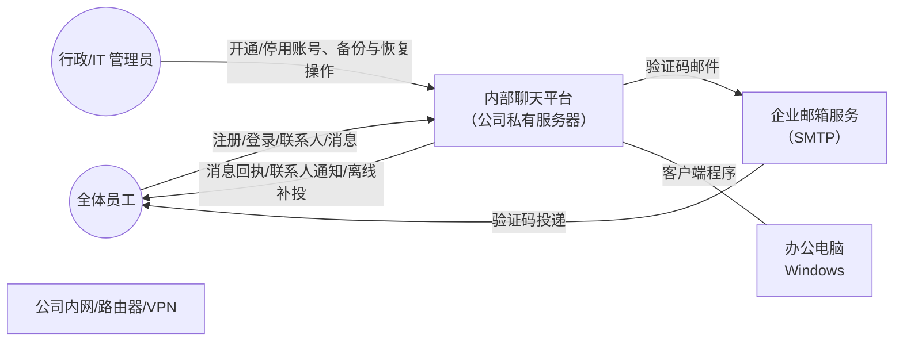

# OpenChat 小公司内部聊天系统 · 需求文档（V0.12）

> **项目名称**：OpenChat —— 小公司内部即时通讯系统（私有部署）
> **文档版本**：V0.12（在 V0.11 基础上按需求工程方法复核修订：目标层、业务事件层、编号体系与可取证性）
> **初稿日期**：2026-10-29　**本次修订**：2026-11-17
> **编制人**：余浩然、林健华、易俊辰
> **阅读提示**：本文档中标注 **〔待访谈校准〕** 的数字是编制时的假设值，必须在涉众访谈后替换为真实数据；标注 **〔差距〕** 的需求表示当前系统（现状系统 system-as-is）尚不具备，需要开发实现；标注 **〔V0.12 修正〕** 的位置是本次复核改动较大的地方，评审时可优先看这些标记。
>
> **修订记录**
>
> | 版本 | 日期 | 变更 |
> |---|---|---|
> | V0.1 | 2026-10-29 | 初稿：问题、价值、目标、范围、涉众、客户细分、业务事件、优先级、功能与质量需求、差距与风险 |
> | V0.11 | 2026-11-04 | 新增第 8 章"用况模型"（参与者、用况清单、用况图 3 张、5 个完整用况描述 + 9 个提纲、追溯与自查）；原第 8–13 章顺延为第 9–14 章；补充术语表 |
> | V0.12 | 2026-11-17 | 需求工程复核，共 9 处实质修改：①统一版本号，并解决**验收标准与参与者共用 AC 编号**的冲突（验收标准改为 VC-01~VC-11）；②问题陈述补根因分析（§1.6），说明 P-1~P-5 是同一根因的五种表现；③目标层补"目标↔痛点"映射、**M-3 与 M-5 的口径矛盾修正**与目标满足性论证（§3.3）；④范围层补"问题空间 vs 解决方案范围"两层含义辨析（§4.1）；⑤业务事件层补 BE-11 的性质判定与**相邻系统×事件交叉检查**（§7.4，查出 2 处缺口）；⑥删除 §7.2 与 §8.6 重复的两则简写，行为规约统一到 §8.6、验收口径统一到 §14.1；⑦优先级由 S/M/L 改为**事件点数**并补认可投票过程（§9.1）；⑧质量需求补"度量条件与取证方法"（§11）、约束/假设/风险补"失效后果、触发条件、责任人"（§12、§13）；⑨追溯矩阵补"目标"列，新增合规涉众 SH-13 与个人信息保护约束 C-7 |

---

## 摘要

某 80 人规模的小公司〔待访谈校准〕目前依赖员工个人微信、QQ 与电话开展内部沟通。敏感沟通数据（报价、合同、财务、人事）经第三方平台流转，公司无法控制其留存与回收；工作与生活沟通混在一起；人员离职时沟通记录与权限无法统一处置；商业云协同工具又带来持续订阅成本与数据托管顾虑。本项目拟在公司自有服务器上部署一套内部聊天系统（基于 OpenChat 现有技术栈改造），为员工提供公私分离、数据自主、可留痕可回收的一对一沟通渠道。本文档按需求工程"项目启动"方法界定真实问题、价值、目标、范围、涉众、客户细分与业务事件，**并按 RE 04 / SR 02 的用况建模方法给出参与者、用况、用况图与用况描述（第 8 章）**，最后给出 MVP 优先级、功能/质量需求清单，以及当前系统与业务要求之间的差距。

V0.12 在此基础上做了一次复核性修订。修订的重点不是增加内容，而是把**"目标—问题—需求—验收"四层之间的链接补齐并把重复的地方删掉**：一条需求必须能回答"它解决哪个痛点、支撑哪个目标、由哪个验收用例取证"，否则就是可疑需求。修订明细见修订记录，改动较大处以 **〔V0.12 修正〕** 标注。

---

## 1. 问题陈述（真实业务问题）

### 1.1 现状（As-Is）

公司约 80 人〔待访谈校准〕，内部工作沟通目前依赖：

- **员工个人微信 / QQ**：绝大多数日常沟通、文件互传、临时通知；
- **电话**：紧急事项；
- **邮件**：少量正式文件。

没有统一的内部沟通工具；人员、账号、记录分散在每名员工的个人设备与个人账号中。

### 1.2 痛点

| 编号 | 痛点 | 说明 |
|---|---|---|
| P-1 | **敏感数据失控** | 客户报价、合同条款、财务单据、人事事项经第三方平台（微信/QQ）流转，聊天记录存放在员工个人手机与第三方服务器上，公司既无副本也无处置权（保密性缺失） |
| P-2 | **离职无法回收** | 员工离职后，与客户/同事的对接记录留在其个人微信中，无法移交；其个人账号仍可继续接收公司相关群消息 |
| P-3 | **公私不分** | 工作通知混入员工私人消息流，重要通知易被淹没；员工也被迫把私人微信交给同事和上级，缺乏边界 |
| P-4 | **沟通无留痕** | 口头承诺、需求变更、审批确认散落在各处聊天中，出现纠纷时无据可查 |
| P-5 | **商业替代方案不适配** | 钉钉/企业微信等云协同工具数据存于第三方云，组织架构、审批等能力按人头收费；对小公司而言既担心数据托管，又难以接受持续订阅成本 |

### 1.3 影响（待访谈校准）

以下数字来自初步访谈与行政口径，属于**待验证的估计**，不足以支撑立项决策，须在 §5.3 三份访谈完成后替换：

- 初步访谈中 6/8 名受访员工表示"工作沟通被迫使用个人微信"；
- 上一年度发生 2 起因员工离职导致客户对接记录无法移交的事件；
- 行政确认无法回答"公司现在有多少个工作群、群主是谁"。

> 说明：上一版此处写作"假设（根据社交媒体）"，把传闻与事实混在一处。V0.12 明确区分三类证据——**有记录的事实**（如离职事件数，可查人事档案）、**访谈陈述**（如员工说法，需注明样本量）、**猜测**（如"大概率需要群聊"）。只有前两类可以写进问题陈述，第三条只能进风险（§13）。

### 1.4 不解决的后果

随人员规模增长，上述问题按人头线性放大：敏感信息泄露面扩大、离职交接成本上升、纠纷举证持续无据。问题不会自行消失，只会更贵。

### 1.5 一句话问题定义

> **公司的内部工作沟通发生在公司无法控制的渠道上，敏感信息、沟通记录与访问权限因此不可控、不可回收、不可追溯。**

### 1.6 根本原因（Root Cause）〔V0.12 修正〕

把 P-1~P-5 当作五个独立问题逐条解决，会得到五个补丁；它们背后是同一条因果链。连问三次"为什么"：

| 追问 | 回答 | 推论 |
|---|---|---|
| 为什么敏感沟通跑到了微信上？ | 因为公司从未提供任何内部沟通渠道 | 缺的是渠道，不是员工不守规矩 |
| 为什么没有提供渠道？ | 因为过去规模小，当面与电话够用；云协同工具按人头收费、数据托管给第三方，被否决 | 规模越过临界点后，原有方式失效 |
| 为什么现在必须解决？ | 人员增长、离职事件、纠纷举证需求同时出现 | 问题随时间变贵，不会自行消失 |

**根因陈述**：公司缺少一个**由自己控制、可管理、可留痕**的内部沟通渠道，而员工手上唯一的替代方案（个人微信/QQ）在控制权上恰好相反。P-1~P-5 是这条根因的五种表现。

由此得到两条对方案的硬约束，也是后续所有需求的源头：

1. **只解决其中一条不会生效**。例如"发通知要求大家少用微信"——渠道没变，行为不会变。
2. **方案形态被根因限定**：必须"私有部署 + 账号可管 + 记录可留"。因此本次不是"再装一个聊天软件"，而是"把沟通的控制权搬回公司"。§3 的目标与 §4 的范围都由此推得。

---

## 2. 价值主张

| 价值接收者 | 功能价值（能多做什么 / 少做什么） | 心理价值 |
|---|---|---|
| 全体员工 | 有一个纯工作的沟通入口；消息不因对方离线而丢失（离线暂存后）；从个人微信中分离出工作关系 | 公私边界感；不用把私人微信交给同事；重要通知不淹没 |
| 部门主管 | 工作安排有统一出口，员工在电脑前即可响应；人员离职时下属对接记录可留存在系统内 | 对下属沟通有掌控感；减少"没收到消息"的扯皮 |
| 行政 / IT 管理员 | 账号集中开通与停用；数据备份在公司自己的设备上；故障排查不依赖外部客服 | 自主可控的踏实感；离职处置当天可完成 |
| 总经理（发起人） | 敏感沟通数据留在公司控制范围内；零订阅费；人员流动风险可控 | 保密与合规的安心；对上/对外可说明数据治理方式 |
| 开发者（你） | 真实业务场景驱动学习项目；每个业务事件都是可演示、可交付的成果 | 作品集价值；需求—开发—部署全流程实践 |

**不解决的价值损失**：P-1 至 P-5 持续存在，且每一次离职、每一次纠纷都会重新付费（时间与风险）。

---

## 3. 项目目标（Goal Statement）

> 方法依据：第 5.1 节。Goal 不是"做一个软件"，而是解决业务问题；必须体现价值且可衡量，采用 目的—收益—衡量指标（Purpose–Advantage–Measurement）三段式。

### 3.1 目标陈述

- **Purpose（目的）**：让公司全部工作沟通发生在一个**仅运行于公司自有服务器**的内部渠道中，使工作沟通与个人生活分离，敏感沟通数据不出公司控制范围，人员离职时沟通记录与访问权限可统一处置。

- **Advantage（收益）**：
  - 相比个人微信/QQ：数据自主可控、账号可管理可停用、记录可留存可移交、公私分离；
  - 相比商业云协同工具：零订阅费、数据不托管给第三方、可按公司实际需要裁剪功能；
  - 相比现状（电话 + 个人微信）：消息有送达保障、有留痕、有统一入口。

- **Measurement（衡量指标）**：
  | 编号 | 指标 | 目标值 | 针对的痛点 | 统计口径 |
  |---|---|---|---|---|
  | M-1 | 上线 3 个月内周活跃员工占全员比例 | ≥ 80% | P-3 公私不分 | 按 uid 去重统计当周登录过的人数 / 在册员工数 |
  | M-2 | 抽查敏感沟通（报价/合同/财务）经由内部渠道的比例 | ≥ 90% | P-1 敏感数据失控 | 抽样 30 段沟通，只记录渠道分布，不读取内容 |
  | M-3 | 消息投递成功率（含离线暂存后补投递） | ≥ 99.9% | P-4 沟通无留痕 | **仅在系统可用时段内**统计：已送达 / 尝试投递 |
  | M-4 | 离职员工账号当日停用率 | 100% | P-2 离职无法回收 | 停用时间 ≤ 离职日 23:59 |
  | M-5 | 工作时间（工作日 8:30–18:30）系统可用率 | ≥ 99% | 全部痛点（不可用即倒退回微信） | 排除计划内维护窗口，按探活成功率计算 |
  | M-6 | 员工季度满意度问卷 | ≥ 4 / 5 | P-3、P-5 | 5 级量表均值，有效回收率 ≥ 60% |

  **目标冲突检查**〔V0.12 修正〕：M-3（≥99.9%）与 M-5（≥99%）在上一版存在口径矛盾——系统可用率只有 99%，意味着每 30 天约有 7.3 小时不可用；若把不可用时段的消息也算作"投递尝试"，99.9% 在数学上不可能达成。修法不是降低指标，而是**把两个承诺分开**：M-5 度量"服务在不在"，M-3 度量"服务在的时候消息有没有丢"。两者相乘才是用户真正体验到的可靠性，这一点在 §3.3 的取证方式中已固定。

### 3.2 可实现性检查（Achievable Goals）

| 约束 | 评估 |
|---|---|
| 服务器：公司自有/托管服务器 1 台（4 核 8 GB 量级即可支撑 100 人以下规模） | 可实现 |
| 运维：无专职运维，由行政/IT 兼任，运维操作必须傻瓜化（脚本化备份、一键启动） | 需按此约束设计 |
| 开发资源：开发者 3人（业余时间），进行openchat开发 | 决定了 MVP 必须小 |
| 外部依赖：注册/找回密码依赖邮件验证码，需要可用的企业邮箱 SMTP | ！ 部署前提，需行政确认 |
| 群聊能力：当前系统不具备（见 §10.2 差距 G-4），而小公司场景大概率需要，后续实现 | ！ 最大风险项，见 §13 风险 |

### 3.3 目标满足性论证（Satisfaction Argument）〔V0.12 新增〕

目标不是愿望，而是可被证伪的断言。上一版给出了 6 个指标，但没有说"由谁、用什么、在什么时候取证"，于是目标在验收时会退化成一堆说法。下表为每个指标固定取证方式——**若某项无法说清取证路径，它就还不算目标，应回到 3.1 重写**。

| 指标 | 达成判据 | 取证方式 | 责任人与时点 | 未达成时的动作 |
|---|---|---|---|---|
| M-1 周活 ≥80% | 连续 4 周达标 | 服务端登录日志（按 uid 去重、按周聚合） | 开发者，上线后第 4/8/12 周 | 访谈未使用者，区分"不知道"与"不需要" |
| M-2 敏感沟通 ≥90% | 抽样 ≥30 段 | 主管访谈 + 渠道抽样记录（不读取内容） | 总经理指定人，上线第 3 个月 | 低于 70% 则把文件传输提前（见 R-2） |
| M-3 投递成功率 ≥99.9% | 可用时段内 已送达/尝试 ≥99.9% | 消息状态表统计，剔除停机时段 | 开发者，每月 | 沿 G-1 路径定位丢失点 |
| M-4 停用率 100% | 停用时间 ≤ 离职日 23:59 | 处置日志 × 人事离职记录比对 | 行政，每月 | 补停用并复盘交接流程 |
| M-5 可用率 ≥99% | 探活通过率达标 | 外部探活脚本（非本机），每 5 分钟一次 | 运维，每月 | 分析停机类型，评估 R-3 |
| M-6 满意度 ≥4/5 | 有效回收率 ≥60% | 季度匿名问卷（5 级量表） | 行政，每季度 | 对低分项做定向访谈 |

> 这张表还暴露了一个设计约束：**M-5 必须由系统之外的探活来取证**。若探活脚本与聊天服务跑在同一台机器上，服务器整机宕机时无人记录——这正是 §7.4 交叉检查中"系统自身不可用没有对应事件"的那处缺口。

---

## 4. 范围（Scope）

> 方法依据：第 5.2–5.4 节。Context 图把系统当黑盒，只画外部实体与数据流；范围由 Goals 决定，先广后收。

### 4.1 Context 图（上下文图）



**相邻系统说明**：

| 相邻系统 | 交互内容 | 控制权 |
|---|---|---|
| 企业邮箱服务 | 系统发出验证码/通知邮件 → 员工收信 | 不可控（可更换供应商），影响轻微 |
| 公司内网/VPN | 承载客户端与服务端的连通性；远程办公经 VPN 接入 | 公司可控 |
| 办公电脑（Windows） | 运行客户端程序 | 公司可控 |

**范围的两层含义**〔V0.12 修正〕：本文档里"范围"出现两次，指的不是同一件事，混用会造成两种典型错误——把方案当前提，或把技术选型当需求。

| 层次 | 含义 | 边界由谁决定 | 本文档中的位置 |
|---|---|---|---|
| 问题空间（工作范围） | 需要被研究与改进的业务：谁在什么场景下沟通、哪些信息必须留在公司内、离职时谁有权处置什么 | 目标（§3）与业务本身 | §1、§4.1 的相邻系统与数据流 |
| 解决方案范围 | 本期打算交付的系统能力：一对一文本、账号生命周期、备份 | 资源与工期（§12 约束） | §4.3 In / Out of Scope |

Context 图画的是**前者**：它只说明"工作"与外部世界交换什么，不说明软件有哪些模块。因此图中出现"办公电脑"并不多余——谁给员工装客户端、装不上找谁、电脑坏了记录还在不在，都是需要研究的范围；而这些恰恰是纯软件视角最容易漏掉的部分。

> 数据守恒预告：所有从系统流出的数据（备份文件、验证码邮件、补投递消息）都必然有对应的输入来源，检查表见附录 B。

### 4.2 授权改变区域 与 影响区域

- **授权改变区域（Charter to Change）**：公司内部工作沟通的方式——员工从此用内部平台进行工作沟通；行政/IT 的账号与备份操作方式。
- **影响区域（Zone of Influence）**：员工的个人沟通习惯（公司不能命令员工删除微信，只能靠"工作沟通必须走内部渠道"的制度 + 更好用的产品去影响）；邮件服务商（可议价更换，影响轻微）。

### 4.3 范围清单

**In Scope**

- 一对一文本消息（在线实时 + 离线暂存补投递）
- 联系人（好友）管理：搜索、申请、认证、列表
- 账号生命周期：邮箱验证码注册（限公司邮箱域）、登录、找回密码、管理员停用/启用
- 消息记录留存与本人查询
- 每日自动备份与恢复预案
- Windows /Linux跨平台桌面客户端

**Out of Scope**

| 排除项 | 理由 |
|---|---|
| 群聊 | 当前系统不具备；小公司场景大概率刚需 → 列为二期首选，见 §13 风险 R-1 |
| 文件/图片传输 | 当前系统不具备；涉密文件恰是用户最不想走微信的内容 → 二期，风险 R-2 |
| 音视频通话 | 成本高，非核心痛点，后续如果有空再实现 |
| 移动端 App | 一期以桌面办公场景为主，后续如果有空会尝试安卓移植 |
| 已读回执、消息撤回 | 体验增强项，非 MVP（后续商议做不做，因为会涉及到隐式问题） |
| 对接考勤/OA/审批系统 | 小公司暂无此系统，属范围外（不考虑） |

---

## 5. 涉众分析

> 方法依据：第 5.5 节。洋葱图三层同心：中心为预期解决方案（边界初期模糊），向外为运营工作区、组织其他部分、外部世界。

### 5.1 洋葱图


- **中心**：内部聊天平台 OpenChat（云状，边界待定）
- **① 运营工作区**：全体员工、行政/IT 管理员、总经理（发起人）、开发者/业务分析师
- **② 组织其他部分**：部门主管、财务负责人、行政主管
- **③ 外部世界**：企业邮箱服务、服务器/网络与备份介质、开源社区（Qt/asio）、离职员工、外部攻击者

### 5.2 涉众登记表

| 编号 | 涉众 | 所属层 | 角色类型（书 5.5） | 关注点 | 影响力 | 参与方式 | 主要需求来源 |
|---|---|---|---|---|---|---|---|
| SH-01 | 全体员工 | 运营区 | Customer as User | 好用、消息不丢、公私分离 | 中 | 访谈、试用反馈 | 日常沟通场景 |
| SH-02 | 行政/IT 管理员 | 运营区 | Customer as User + 相邻系统代表（运维） | 部署简单、备份可靠、离职当天停用 | 高 | 深度访谈 | 账号与运维流程 |
| SH-03 | 总经理 | 运营区 | Project Sponsor + Customer as Purchaser | 保密性、零订阅费、人员流动风控 | 高（拍板人） | 立项评审 | 目标与衡量指标 M-1~M-6 |
| SH-04 | 开发者（编制人） | 运营区 | BA / Product Owner / 架构师 | 需求明确、范围可控、可交付 | 高 | 全程 | 本文档 |
| SH-05 | 部门主管 | 组织层 | 功能/政治受益者 | 下属响应及时、离职留痕 | 中高 | 访谈 | 通知下达、跨人沟通 |
| SH-06 | 财务负责人 | 组织层 | Financial Beneficiary | 零订阅费、预算内 | 中 | 预算确认 | 成本约束 |
| SH-07 | 行政主管 | 组织层 | 功能受益者 / 制度约束 | 入离职流程衔接、制度配套 | 中 | 访谈 | 账号生命周期规则 |
| SH-08 | 企业邮箱服务 | 外部层 | 相邻系统 | 邮件送达率、发信限额 | 中 | 接口文档/配额确认 | 验证码邮件 |
| SH-09 | 服务器/网络/备份介质 | 外部层 | 相邻系统 | 稳定性、带宽、备份可靠性 | 中 | 运维预案 | 部署约束 |
| SH-10 | 开源社区（Qt/asio） | 外部层 | 顾问（知识来源） | 版本兼容、安全补丁 | 低 | 文档/社区 | 技术约束 |
| SH-11 | 离职员工 | 外部层 | Hostile Stakeholder | 离职后仍想拿走记录/继续访问 | 中 | 威胁建模 | 停用即失效、数据回收 |
| SH-12 | 外部攻击者 | 外部层 | Hostile Stakeholder | 窃取通信内容、爆破账号 | 中 | 威胁建模 | 密码哈希、TLS、token |
| SH-13 | 法务／外部合规顾问〔V0.12 新增〕 | 外部层 | 监管者 | 员工个人信息处理是否合规：告知同意、最小必要、留存期限、管理员权限边界 | 中高（可否决） | 制度评审 | 留存期限、告知文本、NFR-07 的边界 |

**为什么必须补 SH-13**：本文档承诺"管理员不可读取员工消息"（NFR-07）、"历史消息按留存策略保留"（UC-09）、"离职后记录可移交"。这三条在技术上都能做到，但在法律上都属于**处理员工个人信息**，需要：明确的告知与同意、约定的留存期限（不能"永久保留"）、以及比"系统里写死了不能查"更硬的约束（数据库层权限与审计）。缺了 SH-13，NFR-07 就只是一句善意；有了 SH-13，它才成为可被审查的约束（见 §12 C-7）。

### 5.3 访谈纪要（占位）

后续通过调查再填写

- 访谈一（行政/IT 管理员）：待补
- 访谈二（部门主管）：待补
- 访谈三（总经理，立项确认）：待补

---

## 6. 客户细分与画像

> 方法依据：第 6 章。先按"需要完成的业务问题"细分，再建画像，最后排优先级。

### 6.1 客户细分

| 客户群体 | 特征与场景 | 核心诉求 | 优先级 |
|---|---|---|---|
| 一线业务员工（销售/客服/采购） | 对外沟通多，报价/合同等敏感内容高频；手机微信里客户与家人混在一起 | 敏感沟通走公司渠道；电脑端专注沟通 | P0 |
| 技术/后台员工（研发/财务/行政） | 整日在电脑前，双屏办公 | 桌面端常驻、消息可靠送达、不被私人消息打断 | P0 |
| 管理者（部门主管及以上） | 一对多沟通多，希望拉群；需要确认下属收到 | 群聊（当前缺失，见差距 G-4）；消息触达确认 | P1 |
| 行政/IT 管理员 | 兼职运维，不懂代码 | 部署/备份/停用操作简单可靠 | P0 |

### 6.2 客户画像（Persona）

**画像一：小周（销售，26 岁）**
- 场景：给客户发报价前，习惯先在微信里和主管确认；报价单曾发错过群。
- 痛点：工作消息混在 200+ 个微信会话里；离职交接时微信记录带不走也留不下。
- 成功标准：报价沟通全程在公司渠道；半年后离职的同事，其客户对接记录主管还能查到。

**画像二：老李（研发主管，38 岁）**
- 场景：同时带 5 个下属，同一件事要对 5 个人说 5 遍。
- 痛点：系统没有群聊，只能挨个发（暴露需求冲突：他的最高诉求落在二期范围）。
- 成功标准：一条通知发出去，系统告诉他"谁没收到"。

**画像三：张姐（行政兼 IT，31 岁）**
- 场景：每月 1–2 人入职、离职；公司只有她"懂点电脑"。
- 痛点：现在的微信工作群她管不了；一旦系统出问题她无法求助。
- 成功标准：新员工 10 分钟内用公司邮箱注册成功；离职当天点一下"停用"，对方立即登录不上去；备份每周自动落盘，她看得懂备份日志。

### 6.3 优先级说明

一线业务员工与行政/IT 管理员构成 P0：前者决定系统"有没有人用"（M-1），后者决定系统"能不能活下来"（备份与账号处置）。管理者群体 P1——其核心诉求（群聊）依赖二期能力，一期以"消息触达确认"部分缓解。

---

## 7. 业务事件（Business Events）

> 方法依据：第 7 章。业务事件 = 外部世界发生、需要系统响应的事情；三类：业务用况（人触发）、时间触发、条件触发。每个事件的响应即业务用况（BUC）。

### 7.1 业务事件清单

| 编号 | 业务事件 | 类型 | 触发者 | 触发数据 | 系统响应（BUC 概要） | 输出 | 数据存储 |
|---|---|---|---|---|---|---|---|
| BE-01 | 新员工申请开通账号 | 业务用况 | 新员工 | 公司邮箱地址 | 校验邮箱域名白名单 → 生成验证码（有效期 300s）→ 发送邮件 → 校验注册信息 → 创建账号并分配 uid | 验证码邮件、注册结果 | user、uid 分配器 |
| BE-02 | 员工登录 | 业务用况 | 员工 | 邮箱 + 密码 | 两步验证：网关校验密码 → 状态服务分配聊天服务器并签发 token → 客户端建立长连接二次鉴权 → 拉取资料/联系人/申请 | 登录结果、在线状态 | token（Redis）、连接数 |
| BE-03 | 员工忘记密码 | 业务用况 | 员工 | 邮箱 + 验证码 + 新密码 | 校验验证码与账号匹配 → 更新密码（哈希存储） | 重置结果 | user |
| BE-04 | 员工搜索同事并发起联系人申请 | 业务用况 | 员工 | uid 或用户名、附言 | 查询目标用户 → 写入申请记录（待处理）→ 对方在线则实时推送 | 申请通知 | friend_apply |
| BE-05 | 对方处理联系人申请 | 业务用况 | 员工 | 申请记录、同意/拒绝 | 同意则建立双向联系人关系；通知双方 | 认证结果通知 | friend、friend_apply |
| BE-06 | 员工发送消息 | 业务用况 | 员工 | 目标 uid、文本内容 | 先向发送方回执 → 查询接收方所在服务器 → 同服直推 / 跨服 RPC 转发 → 在线投递；**离线则暂存，待上线补投**〔差距〕 | 送达回执、消息 | 消息记录表〔新增〕 |
| BE-07 | 员工退出登录 | 业务用况 | 员工 | 下线请求 | 断开长连接、释放会话、更新在线连接数 | — | 连接数（Redis） |
| BE-08 | 验证码到达有效期终点 | 时间/条件触发 | 系统 | 300 秒计时 | 验证码失效，需重新申请 | — | code_<email> 过期删除 |
| BE-09 | 到了每日备份的时间 | 时间触发 | 系统 | 凌晨 2:00 | 导出 MySQL 全量 + Redis 快照 → 压缩加密 → 写入备份存储 → 校验并记录备份日志 | 备份文件、备份日志 | 备份存储 |
| BE-10 | 员工离职，管理员停用账号 | 业务用况 | 行政/IT 管理员 | 目标 uid | 立即断开会话 → 标记账号停用（禁止登录）→ 记录处置信息；其消息记录按留存策略保留〔差距〕 | 停用确认 | user（状态位）、处置日志 |
| BE-11 | 消息发出后接收方长时间离线 | 条件触发 | 系统 | 投递未成功计时 | 消息转入离线暂存队列并标记"未送达"，接收方上线后按序补投〔差距〕 | 未送达标记、补投递 | 离线消息表 |
| BE-12 | 到了生成使用简报的时间 | 时间触发（P2） | 系统 | 每周一 9:00 | 汇总上周活跃人数、消息量，发送给发起人 | 使用简报 | 统计表 |

### 7.2 与用况描述、验收用例的关系〔V0.12 修正〕

上一版在此处放了两则"给定—当—则"简写（发送消息、停用账号），而 §8.6.4（UC-07）与 §8.6.5（UC-09）描述的是同一件事，§14.1 的验收用例又写了一遍——同一行为出现三份叙述，改一处就会不同步。V0.12 删除本节重复内容，改为一张索引，并明确**单一真相源**：

| 内容类型 | 唯一来源 | 其它位置只做引用 |
|---|---|---|
| 行为规约（前置/后置条件、基本流、备选流） | §8.6 的用况描述 | §8.4 只给简要描述 |
| 验收判据（可执行的检查项） | §14.1 的 VC 用例 | §8.6 的"特殊需求"只引用指标编号 |

| 业务事件 | 规约（唯一来源） | 验收用例 |
|---|---|---|
| BE-06 员工发送消息（含离线） | §8.6.4 UC-07 | §14.1 VC-05、VC-06 |
| BE-10 管理员停用账号 | §8.6.5 UC-09 | §14.1 VC-07 |

### 7.3 数据守恒检查（第 7.2.4 节）

| 输出 | 输入来源 | 检查结果 |
|---|---|---|
| 离线补投递的消息 | BE-06 发送的消息内容 | ✅ 有来源（前提是消息必须落库 → 引出差距 G-1） |
| 每日备份文件 | BE-01/02/04/05/06 写入的数据 | ✅ 有来源 |
| 使用简报（BE-12） | 在线连接数、消息记录 | ✅ 有来源 |
| **当前系统的"消息记录查询"能力** | **无消息收发与存储层 → 无输入来源** | ❌ **数据守恒缺口：必须新增消息收发与存储，否则任何留痕/离线/审计输出都无从谈起** |

### 7.4 事件清单的两项交叉检查〔V0.12 新增〕

**（A）性质检查：BE-11 不是严格意义上的业务事件。**

业务事件的定义是"在系统之外发生、需要系统响应的事情"。BE-06~BE-10 都符合；BE-11"消息发出后接收方长时间离线"不同——它是**系统自己发现投递没成功**，属于 BE-06 响应过程中的内部状态，不是外部发生的事件。保留它的唯一理由是它是离线能力的验收锚点（VC-06）。评审时应作二选一：要么降为 BE-06 的条件分支（推荐，概念更干净），要么在事件表里注明"内部触发、仅供验收引用"。**不能既把它当业务事件，又在 §8.7 说它"不构成用况"**——上一版就是这种双重身份。

**（B）覆盖检查：每条输入流都有事件认领吗？**

业务事件清单最常见的错误不是写错，而是漏写。检查方法是反过来走一遍 §4.1 的上下文图：逐个相邻系统问"它送进来的每样东西，由哪个事件接收"。

| 相邻系统 / 输入流 | 认领的业务事件 | 结果 |
|---|---|---|
| 员工 → 注册信息、验证码 | BE-01 | ✅ |
| 员工 → 登录凭据 | BE-02 | ✅ |
| 员工 → 找回密码请求 | BE-03 | ✅ |
| 员工 → 搜索、申请、认证动作 | BE-04、BE-05 | ✅ |
| 员工 → 消息内容 | BE-06 | ✅ |
| 员工 → 下线请求 | BE-07 | ✅ |
| 管理员 → 停用/启用指令 | BE-10 | ✅ |
| 管理员 → 手动备份指令 | BE-09（手动分支） | ✅ |
| 作业调度器 → 定时触发 | BE-09、BE-12 | ✅ |
| 企业邮箱服务 → 投递成功/退信 | 无 | ❌ **缺口 1**：发信失败目前只在 UC-01 备选流 A6 中被处理，没有事件可统计。若 SMTP 退信率上升，无人能发现趋势。建议补 BE-13"验证码邮件投递失败"（条件触发），或明确接受"不可统计" |
| 网络/服务器 → 自身不可用 | 无 | ❌ **缺口 2**：没有"系统自身不可用"的事件，因此 M-5 只能靠**系统之外**的探活取证（见 §3.3）。若沿用系统内健康检查，宕机时无人记录，可用率永远显示 100% |

> 两条缺口的处置不必在本版关闭，但必须进入附录 C 的行动清单——**风险要写在纸上，不能留在脑子里**。

---

## 8. 用况模型（Use-Case Model）

> 方法依据：RE 04《Finding Actors and Use Cases》与 SR 02《Fundamentals of Use-Case Modeling》。本章把 §7 的业务事件转写为标准用况模型：先划边界，再找参与者，再由参与者目标导出用况，最后给出用况图与用况描述。**用况模型回答"谁为了什么目标使用系统"；功能需求清单（§10）回答"系统内部要实现哪些能力"。前者是价值的来源，后者是派生的实现视图。**

### 8.1 建模约定

> 以下七条约定在建模开始前固定，用于避免"用况退化为功能分解"这一最常见错误。

| # | 约定 | 依据 | 在本模型中的体现 |
|---|---|---|---|
| 1 | 用况是"参与者为达成某个目标与系统进行的一次完整交互"，不是功能点、不是菜单项 | RE 04 §3.4；SR 02 §用况 | "获取验证码"不单独成用况——它不独立产生价值，是 UC-01 基本流第 1–4 步 |
| 2 | 用况必须由参与者启动，且至少为一个参与者产生可识别的价值 | SR 02 §用况定义 | UC-01 的价值是"我拿到了一个能登录的公司账号"，而不是"系统生成了一个 uid" |
| 3 | 用况之间相互独立，不使用 include / extend；共用步骤用"子流"表达 | RE 04 §3.9 | "登录"不作为各用况的 include，而是各用况的前置条件 |
| 4 | 设备不是参与者；设计者可自主选择的技术不是参与者 | RE 04 §1.7–1.8 | 办公电脑、MySQL、Redis、聊天服务器均不建模为参与者（见 §8.2） |
| 5 | 时间触发用"作业调度器"而非"系统时钟" | RE 04 §1.9 | AC-05 作业调度器启动 UC-11、UC-14 |
| 6 | 用况名用主动动宾短语 | RE 04 §4.2 | "发送消息"而非"消息发送"；被动名易与职能部门混淆 |
| 7 | 用况描述由前置条件、后置条件、基本流、备选流构成 | SR 02 §用况描述 | 基本流控制在 5–10 步；错误与例外占备选流的主体 |

**一条推论**：既然用况不描述内部结构，本模型不出现"数据库""长连接""RPC"等实现词汇；这些属于 §10 功能需求与后续设计文档。

### 8.2 系统边界

**边界陈述**：系统边界从"员工在客户端发起注册/登录"开始，到"消息落库、可被查询、可被备份恢复"为止。邮件投递、服务器硬件、操作系统、数据库引擎、缓存中间件均在边界之外或属于实现选择。

| 候选对象 | 是否参与者 | 判定理由（依据 RE 04） |
|---|---|---|
| 办公电脑 / Windows 客户端 | **否**（设备） | 设备只是参与者与系统通信的机制。把键盘当作用户，会丢失系统的真正目标 |
| MySQL / Redis / 备份存储介质 | **否**（设计选择） | 设计者可自主决定何时、如何、是否使用；用况只记录"必须完成什么"，不记录"用什么完成" |
| GateServer / VerifyServer / 聊天服务器 | **否**（边界内构件） | 属系统内部结构；用况不描述内部设计 |
| 企业邮箱服务（SMTP） | **是**（外部系统） | 系统无法控制其可用性；它不可用时 UC-01 必须终止。经验法则："如果你不能控制它，它就是一个参与者" |
| 离职员工 | **否**（敌对涉众） | 离职后不再与系统交互；"仍想继续访问"是威胁而非角色，由 UC-09 后置条件与 NFR-06 约束 |
| 部门主管 / 总经理（作为使用者） | **否**（被 AC-01 覆盖） | 他们登录后扮演的就是"员工"角色；职位不是参与者（RE 04 §2.2）。管理者的群聊诉求属范围外，体现为 §13 风险 R-1 |
| 外部客户 | **否**（一期范围外） | 见开放问题 Q-1 |

> 边界判定的收益：把"银行系统算不算参与者"式的争论（RE 04 开篇的 ATM 例）在本项目中一次性关闭，避免后续在"聊天服务器算不算外部系统"上反复。

### 8.3 参与者（Actors）

#### 8.3.1 识别过程

按 RE 04 的顺序三步走，而不是一次性头脑风暴：

1. **先找主参与者**：谁缺了，系统就没有存在必要？→ 员工（AC-01）。
2. **再找支持参与者**：谁提供系统无法自产的信息、或做出系统无法单独做出的决定？→ 账号管理员（AC-02）、运维管理员（AC-03）、企业邮箱服务（AC-04）。
3. **最后找启停与定时参与者**：谁让系统开始/停止、谁在固定时刻触发作业？→ 作业调度器（AC-05）；以及"系统主动向其推送"的受益者 → 简报接收者（AC-06）。

**从具体到一般**：先写下 3 个真实的人（销售小周、研发主管老李、行政张姐，见 §6.2），确认 AC-01 覆盖小周与老李，AC-02/AC-03 覆盖张姐，且张姐一人分饰两个角色——这正是"角色 ≠ 职位"的直接证据。

#### 8.3.2 参与者登记表

| 编号 | 参与者 | 类型 | 简要描述（角色与目标） | 规模 / 使用频率 | 关联用况 | 涉众追溯 |
|---|---|---|---|---|---|---|
| AC-01 | 员工（沟通参与者） | 主参与者 | 在公司内部就工作事项与同事进行一对一沟通的人。目标：找到该找的人、把话说清楚、事后查得回来。 | 约 80 人；工作日 8:30–18:30 常驻在线 | UC-01 ~ UC-08 | SH-01、SH-05 |
| AC-02 | 账号管理员 | 支持参与者（MVP 关键） | 负责员工账号生命周期的人，通常由行政/IT 兼任。目标：入职当天能开通、离职当天能切断、密码问题能兜底。 | 1–2 人；每月 1–2 次入离职 | UC-09、UC-10 | SH-02、SH-07 |
| AC-03 | 运维管理员 | 支持参与者 | 负责服务器部署、备份与恢复的人，常与 AC-02 为同一人。目标：系统挂了能拉起来，数据丢了能恢复。 | 1 人；每周巡检，故障时使用 | UC-11、UC-12、UC-13 | SH-02、SH-09 |
| AC-04 | 企业邮箱服务 | 支持参与者（外部系统） | 承担验证码邮件投递的外部系统。目标：把邮件送达。系统无法控制其可用性。 | 第三方；每次注册/找回触发 | UC-01、UC-04 | SH-08 |
| AC-05 | 作业调度器 | 支持参与者（定时机制） | 在预定时刻启动作业的机制（cron / Windows 计划任务）。目标：按时触发备份与简报，并留下执行状态。 | 每日 1 次、每周 1 次 | UC-11、UC-14 | SH-02 |
| AC-06 | 简报接收者 | 支持参与者（受益） | 每周接收使用简报的决策者。目标：判断系统是否真的被使用（M-1）。 | 1 人；每周一次 | UC-14 | SH-03 |

#### 8.3.3 参与者特征（影响交互设计）

| 参与者 | 使用环境 | 领域知识 | 计算机熟练度 | 对设计的约束 |
|---|---|---|---|---|
| AC-01 员工 | 办公室工位，双屏，常被电话与当面沟通打断 | 熟悉微信/QQ 的会话模型 | 中—高 | 交互必须"不用学"：沿用会话列表 + 聊天窗口的心智模型（NFR-08） |
| AC-02 账号管理员 | 行政工位，非技术岗 | 懂入离职流程，不懂数据库 | 低—中 | 停用操作一步可达，提供"确认 + 原因"；不暴露 SQL 与命令行 |
| AC-03 运维管理员 | 服务器远程终端 | 懂基础 Linux 运维 | 中 | 全部操作为脚本：一键启停、一键备份、一键恢复，输出可读日志（NFR-09） |
| AC-04 企业邮箱服务 | 无界面 | — | — | 需要 SMTP 账号与发信配额（C-2）；失败必须给出可判读的错误 |
| AC-05 作业调度器 | 系统计划任务 | — | — | 需要作业状态日志，便于判断"昨晚的备份到底跑没跑" |
| AC-06 简报接收者 | 手机 / 邮件 | 关注结论不关注明细 | 中 | 简报只给结论与趋势，不给原始数据表 |

#### 8.3.4 参与者完备性检查

- **用户类型 → 参与者**：§6.1 的四类客户（一线业务、技术/后台、管理者、行政/IT）中，前三类由 AC-01 覆盖，第四类拆为 AC-02/AC-03。管理者未被单独建模，因为其"使用系统"的行为与 AC-01 完全相同，差异只体现在范围外的群聊诉求上。
- **参与者 → 用况**：6 个参与者各自至少参与 1 个用况（见 §8.3.2 末列），无冗余参与者。
- **参与者 → 涉众**：AC-01~AC-06 可回溯到 SH-01~SH-09；SH-11（离职员工）、SH-12（外部攻击者）不建模为参与者，理由见 §8.2。

### 8.4 用况清单

> 命名一律为主动动宾短语。"简要描述"回答三件事：为谁、提供什么价值、系统大致做了什么（不重复用况描述）。

#### 8.4.1 业务用况（为员工提供核心价值）

| 编号 | 用况 | 主参与者 | 支持参与者 | 简要描述（价值） | 优先级 |
|---|---|---|---|---|---|
| UC-01 | 注册公司账号 | AC-01 | AC-04 | 新员工用公司邮箱自助取得一个可登录的内部账号，无需管理员手工建号。 | P0 |
| UC-02 | 登录系统 | AC-01 | — | 员工用账号密码进入工作沟通环境，并保持在线以便随时收到消息。 | P0 |
| UC-03 | 退出登录 | AC-01 | — | 员工在共用电脑或下班时结束会话，使自己的身份不再被继续使用。 | P1 |
| UC-04 | 找回密码 | AC-01 | AC-04 | 员工在忘记密码时凭公司邮箱自助恢复访问权，不必等管理员。 | P1 |
| UC-05 | 查找同事并申请联系人 | AC-01 | — | 员工找到某位同事并请求建立联系，从而获得一个可对话的对象。 | P0 |
| UC-06 | 处理联系人申请 | AC-01 | — | 被申请的员工决定是否让对方进入自己的联系人列表，避免陌生人打扰。 | P0 |
| UC-07 | 发送消息 | AC-01 | AC-01（接收方） | 员工把一条工作信息可靠地送达同事；对方离线也不会丢。 | P0 |
| UC-08 | 查询历史消息 | AC-01 | — | 员工事后查回与某位同事此前的沟通内容，用于对账、举证与交接。 | P1 |

#### 8.4.2 支持用况（使系统可运行、可维护）

| 编号 | 用况 | 主参与者 | 简要描述（价值） | 优先级 |
|---|---|---|---|---|
| UC-09 | 停用 / 启用账号 | AC-02 | 管理员在员工离职或调岗时立即切断其访问，并在误操作后可恢复。 | P0 |
| UC-10 | 重置员工密码 | AC-02 | 管理员在员工无法自助找回时兜底恢复访问，并留下处置记录。 | P1 |
| UC-11 | 备份系统数据 | AC-05 / AC-03 | 每日自动产出可恢复的完整备份，使"数据自主"不只是一句口号。 | P0 |
| UC-12 | 恢复系统数据 | AC-03 | 灾难后从备份把系统恢复到可用状态，并验证数据完整。 | P0 |
| UC-13 | 启停系统服务 | AC-03 | 非技术背景的兼职运维能按脚本安全地启动/停止全部服务。 | P0 |

#### 8.4.3 运营用况

| 编号 | 用况 | 主参与者 | 简要描述（价值） | 优先级 |
|---|---|---|---|---|
| UC-14 | 接收使用简报 | AC-05 → AC-06 | 发起人每周看到采用情况（活跃人数、消息量），据此判断项目是否达标。 | P2 |

**为什么只有 14 个用况**：llfcchat 的协议里有 19 个 ReqId（验证码、注册、重置、登录、聊天登录、搜索、申请、认证、发消息……）。若按 ReqId 建用况，会得到 19 个"功能块"；按参与者目标合并后只剩 14 个——搜索与申请合并为 UC-05，申请的发起与处理拆成 UC-05/UC-06 两侧，验证码成为 UC-01 的步骤。这正是 RE 04 §3.4 强调的"不要做功能分解"。

### 8.5 用况图

> 依据 SR 02：一个用况模型可以用多张图从不同透视查看；图只是索引，实质内容在 §8.6 的用况描述中。为可读性，本模型把总览拆为"业务视角"与"支持视角"两张。

#### 8.5.1 业务用况总览（员工视角）


#### 8.5.2 支持用况总览（管理与运维视角）


#### 8.5.3 用况透视：UC-07 发送消息


#### 8.5.4 读图说明

1. **箭头方向表示发起方**：员工指向用况，表示员工启动该用况；UC-14 的箭头从用况指向简报接收者，表示由系统主动投递（SR 02 §通信关联）。
2. **连线不是数据流**：它是参与者与系统之间的会话通道，数据在该通道上双向流动。
3. **一个用况可涉及多个参与者**：UC-07 涉及发送方与接收方两个实例；UC-11 可由作业调度器或运维管理员任一方启动。
4. **图中不出现 include / extend**：本模型的用况相互独立，共用步骤以子流表达（如 UC-01 中"发送验证码"这一段）。

### 8.6 用况描述

#### 8.6.1 描述模板

每个用况按下述结构编写；基本流只写"正常、预期"的路径，所有偏离与错误一律进备选流（SR 02 §事件流）。

```
用况编号与名称
简要描述      一句话：为谁提供什么价值
主参与者 / 支持参与者
前置条件      用况启动时必须为真的状态（不是触发器）
后置条件      成功结束时系统必须处于的状态；失败时的可接受状态
基本流        1..n，5–10 步
备选流        A1..An：何时发生 → 系统如何处理 → 回到基本流哪一步 / 用况如何结束
特殊需求      仅适用于本用况的非功能约束（可选）
```

#### 8.6.2 UC-01 注册公司账号

- **简要描述**：新员工用公司邮箱自助取得一个可登录的内部账号，无需管理员手工建号。
- **主参与者**：AC-01 员工　**支持参与者**：AC-04 企业邮箱服务
- **前置条件**：员工持有公司邮箱域地址；系统已配置邮箱域白名单与 SMTP 参数。
- **后置条件（成功）**：账号已创建并分配 uid，密码以加盐哈希存储，账号状态为"启用"，员工可立即登录。
- **后置条件（失败）**：未创建任何账号，或账号处于未激活状态；员工看到可判读的失败原因并可重试。

**基本流**

1. 员工输入公司邮箱，请求获取验证码。
2. 系统校验邮箱域名在白名单内，且该邮箱未被注册。
3. 系统生成 4 位验证码，与邮箱绑定，有效期 300 秒。
4. 系统经企业邮箱服务发送验证码邮件。
5. 员工查收邮件，输入验证码、用户名、密码与确认密码。
6. 系统校验验证码未过期且与邮箱匹配。
7. 系统校验用户名唯一、密码满足强度规则。
8. 系统创建账号、分配 uid、以加盐哈希保存密码。
9. 系统提示注册成功并引导至登录。

**备选流**

| 编号 | 触发 | 处理 |
|---|---|---|
| A1 | 步骤 2：邮箱非公司域 | 拒绝并提示"仅限公司邮箱注册"，不发送验证码（对应差距 G-2） |
| A2 | 步骤 2：邮箱已注册 | 拒绝并引导至 UC-04 找回密码 |
| A3 | 步骤 6：验证码错误或已过期 | 提示剩余可重试次数；允许重新获取，同一邮箱 60 秒内限一次 |
| A4 | 步骤 7：用户名已被占用 | 保留已填邮箱与验证码，要求更换用户名后重试 |
| A5 | 步骤 7：密码强度不足 | 提示具体规则（长度、字符类别），不清空其他输入 |
| A6 | 步骤 4：邮件服务不可用 | 明确提示"验证码发送失败，请稍后重试"；不进入后续步骤，不创建账号 |
| A7 | 并发：同一邮箱被同时注册 | 以数据库唯一约束兜底，后提交者失败并按 A2 处理 |

**特殊需求**：验证码有效期 300 秒；同一 IP 每小时最多 10 次验证码请求（防刷）。

#### 8.6.3 UC-02 登录系统

- **简要描述**：员工用账号密码进入工作沟通环境并保持在线，从而能随时收发消息。
- **主参与者**：AC-01
- **前置条件**：账号已创建且状态为"启用"；客户端可访问 GateServer。
- **后置条件（成功）**：HTTP 会话通过校验，已签发 token，TCP 长连接建立并通过二次鉴权，在线状态为"在线"，客户端已拉取资料、联系人、待处理申请与未送达消息条数。
- **后置条件（失败）**：未建立长连接，客户端停留在登录页并给出原因；不产生"半登录"状态（能进主界面但收不到消息）。

**基本流**

1. 员工输入邮箱与密码，提交登录。
2. 系统校验账号存在、状态为启用、密码哈希匹配。
3. 系统向状态服务申请分配一台聊天服务器。
4. 系统签发 token（含 uid、聊天服务器地址与端口、有效期）。
5. 客户端凭 token 建立 TCP 长连接。
6. 聊天服务器对 token 做二次鉴权。
7. 系统记录在线状态与连接数。
8. 系统向客户端下发个人资料、联系人列表、待处理申请、未送达消息条数。
9. 客户端进入主界面，开始接收消息。

**备选流**

| 编号 | 触发 | 处理 |
|---|---|---|
| A1 | 步骤 2：密码错误 | 统一提示"账号或密码错误"，累计失败次数；连续 5 次锁定 15 分钟 |
| A2 | 步骤 2：账号已停用 | 提示"账号已停用，请联系管理员"（对应 M-4） |
| A3 | 步骤 2：账号不存在 | 与 A1 使用同一提示，避免账号枚举 |
| A4 | 步骤 3：无可用聊天服务器 | 提示"服务暂不可用，请稍后重试"，记录告警 |
| A5 | 步骤 5–6：长连接建立失败或鉴权超时 | 客户端提示"无法连接聊天服务"并允许重试；HTTP 会话不保留 |
| A6 | 步骤 5：同一账号已在别处登录 | 按假设 A-4（单设备）拒绝新连接并提示"已在其他设备登录"；是否改为踢下线旧连接见开放问题 Q-3 |
| A7 | 步骤 6：token 已过期 | 拒绝长连接，要求重新登录 |

#### 8.6.4 UC-07 发送消息

- **简要描述**：员工把一条工作信息可靠地送达同事；对方离线时消息不丢，上线后按序补投。
- **主参与者**：AC-01 员工（发送方）　**支持参与者**：AC-01 员工（接收方）
- **前置条件**：发送方已登录并保持长连接；双方已建立联系人关系；消息为非空纯文本且不超过 2 KB。
- **后置条件（成功）**：消息已写入消息记录表，接收方可见，发送方收到"已送达"回执。
- **后置条件（失败）**：消息未落库或标记为"未送达"；发送方看到明确的失败/未送达状态；系统中不存在"发送方以为成功、实际已丢失"的中间态。

**基本流**

1. 发送方在会话窗口输入文本并提交。
2. 系统校验会话有效性与联系人关系。
3. 系统生成消息序号与时间戳，写入消息记录表，状态为"待投递"。
4. 系统向发送方回执"已接收"。
5. 系统定位接收方当前所在的聊天服务器。
6. 接收方在线：系统推送该消息。
7. 接收方客户端确认收到，系统将状态更新为"已送达"，并通知发送方。
8. 接收方会话窗口显示消息，用况结束。

**备选流**

| 编号 | 触发 | 处理 |
|---|---|---|
| A1 | 步骤 5–6：接收方离线 | 消息状态置为"未送达"并进入离线队列，发送方看到"未送达"。接收方下次登录后（UC-02 步骤 8）系统按序补投，补投成功后置为"已送达"并清除队列条目（对应差距 G-1、业务事件 BE-11） |
| A2 | 步骤 2：消息为空或超过 2 KB | 拒绝发送并提示长度限制；不落库 |
| A3 | 步骤 2：双方非联系人 | 拒绝发送，提示"对方不在联系人列表"（防骚扰） |
| A4 | 步骤 3：消息落库失败 | 不推送、不回执成功，直接返回"发送失败"；优先保证"不出现无记录的送达" |
| A5 | 步骤 5：接收方在另一台聊天服务器 | 经跨服转发投递，其余步骤与基本流一致 |
| A6 | A1 补投过程中接收方再次掉线 | 已补投部分置为"已送达"，剩余部分保留在队列，下次登录继续 |
| A7 | 步骤 6：推送超时（对方刚掉线） | 转 A1 处理，不重试推送，避免重复投递 |

**特殊需求**：局域网内发送方回执 ≤ 300 ms，在线接收 ≤ 1 s，补投在登录后 5 s 内完成（对应 NFR-01、NFR-03）。

#### 8.6.5 UC-09 停用 / 启用账号

- **简要描述**：管理员在员工离职或调岗时立即切断其访问，并在误操作后可恢复。
- **主参与者**：AC-02 账号管理员
- **前置条件**：管理员已通过管理员身份认证；目标账号存在。
- **后置条件（成功）**：目标账号状态为"停用"，其全部在线会话已断开，再次登录被拒绝，处置记录（操作人、时间、原因）已写入日志，历史消息按留存策略保留。
- **后置条件（失败）**：账号状态未改变，或已标记"待强制断开"，并向管理员给出明确结果与后续动作。

**基本流**

1. 管理员登录管理端，按姓名、邮箱或 uid 检索目标员工。
2. 管理员选择"停用"，填写原因（离职 / 调岗 / 其他）。
3. 系统将账号状态置为"停用"。
4. 系统断开该账号的全部在线连接。
5. 系统写入处置日志（操作人、时间、原因、目标 uid）。
6. 系统向管理员返回停用结果。
7. 该员工后续登录被拒绝（转 UC-02 备选流 A2）。

**备选流**

| 编号 | 触发 | 处理 |
|---|---|---|
| A1 | 步骤 3：目标账号已是停用状态 | 幂等返回"已是停用状态"，不重复写日志 |
| A2 | 步骤 4：连接断开失败 | 账号仍置为停用，连接标记"待强制断开"，由聊天服务器在心跳超时后清除并告警 |
| A3 | 管理员误操作 | 提供同用况的"启用"分支恢复；启用同样写日志 |
| A4 | 目标为管理员本人 | 拒绝操作，防止把自己锁在系统外 |
| A5 | 操作者无管理员权限 | 拒绝并记录越权尝试 |

**特殊需求**：停用后该账号不得再通过任何通道接收消息；历史消息不因停用而删除（NFR-07）。

#### 8.6.6 UC-11 备份系统数据

- **简要描述**：每日自动产出可恢复的完整备份，使"数据自主"不只是一句口号。
- **主参与者**：AC-05 作业调度器（定时）／AC-03 运维管理员（手动）
- **前置条件**：备份存储可用，剩余空间不小于上一份备份体积的 2 倍；MySQL 与 Redis 正在运行；备份脚本与配置文件就位。
- **后置条件（成功）**：产出带日期的备份集（MySQL 全量 + Redis 快照），已压缩加密并通过完整性校验；备份日志记录时间、大小、耗时与校验结果；保留策略已生效。
- **后置条件（失败）**：本次未产出可用备份集，但上一份有效备份未被破坏；告警已发出，日志中可判读失败原因。

**基本流**

1. 作业调度器在每日 02:00 启动备份作业。
2. 系统检查备份存储剩余空间与依赖服务状态。
3. 系统导出 MySQL 全量数据。
4. 系统生成 Redis 快照。
5. 系统将两部分压缩为一个备份集，按日期命名写入备份存储。
6. 系统校验备份集完整性（可解压、表数量与行数同源库一致）。
7. 系统写入备份日志（开始/结束时间、大小、耗时、校验结果）。
8. 系统按保留策略删除超出份数的最旧备份。
9. 用况结束。

**备选流**

| 编号 | 触发 | 处理 |
|---|---|---|
| A1 | 步骤 2：空间不足 | 中止本次作业，保留上一份有效备份，告警"备份空间不足" |
| A2 | 步骤 3–4：导出失败 | 自动重试一次；仍失败则中止并告警 |
| A3 | 步骤 6：校验失败 | 该备份集标记"不可用"并告警，不计入保留份数 |
| A4 | 作业超时（默认 30 分钟） | 中止，记录超时原因并告警 |
| A5 | 运维管理员手动触发 | 同基本流执行，日志标注"手动" |
| A6 | 备份期间数据库不可用 | 跳过本次，记录原因并告警，不产生半成品备份集 |
| A7 | 首次运行，无历史备份 | 跳过保留策略的清理步骤 |

**特殊需求**：备份过程不得阻塞正常消息收发（NFR-04）；备份集加密存储（NFR-06）；RPO ≤ 24 h（NFR-05）。

#### 8.6.7 其余用况提纲

> 提纲（outline）用于在详细描述之前固定规模与结构：基本流 5–10 步，备选流只列编号与触发点（SR 02 §用况提纲）。迭代 1 启动前补齐为完整描述。

| 用况 | 基本流（提纲） | 主要备选流 |
|---|---|---|
| UC-03 退出登录 | 1 员工点击退出 → 2 客户端通知聊天服务器 → 3 服务端释放会话、更新在线状态 → 4 客户端清除本地 token 与缓存 → 5 回到登录页 | A1 通知因网络中断失败（服务端按心跳超时清除，本地仍清凭据）；A2 存在未发出的消息（提示确认） |
| UC-04 找回密码 | 1 输入公司邮箱 → 2 校验域白名单与账号存在 → 3 生成并发送验证码 → 4 输入验证码 → 5 输入新密码 → 6 更新密码哈希 → 7 使旧 token 失效 → 8 提示重新登录 | A1 邮箱未注册（统一提示，防枚举）；A2 验证码错误/过期；A3 新密码与旧密码相同；A4 邮件服务不可用 |
| UC-05 查找同事并申请联系人 | 1 输入 uid/姓名/邮箱 → 2 系统精确匹配并返回结果 → 3 选择目标并填写附言 → 4 校验是否已是联系人、是否已有待处理申请 → 5 写入申请记录 → 6 对方在线则实时推送 → 7 提示"申请已发送" | A1 未找到；A2 已是联系人；A3 存在待处理申请（不重复写入）；A4 目标账号已停用；A5 对方离线（登录后拉取） |
| UC-06 处理联系人申请 | 1 打开申请列表 → 2 返回待处理申请（含附言）→ 3 选择同意或拒绝 → 4 更新申请状态 → 5 同意则建立双向联系人关系 → 6 通知双方 → 7 刷新联系人列表 | A1 拒绝；A2 申请已被撤回或过期；A3 双方已互为联系人（幂等）；A4 申请方账号已停用 |
| UC-08 查询历史消息 | 1 打开与某联系人的会话 → 2 按时间倒序返回最近一页（13 条）→ 3 向上滚动加载更早一页 → 4 展示消息与时间戳 | A1 无历史记录；A2 会话对象已停用（只读可查）；A3 分页越界 |
| UC-10 重置员工密码 | 1 管理员检索员工 → 2 选择重置 → 3 生成临时密码 → 4 记录处置日志 → 5 当面或经邮箱告知员工 → 6 员工首次登录强制改密 | A1 目标账号已停用；A2 无权限；A3 通知渠道不可用 |
| UC-12 恢复系统数据 | 1 选择备份集 → 2 校验备份完整性 → 3 停止写入（停服）→ 4 恢复 MySQL → 5 恢复 Redis → 6 启动服务并自检 → 7 记录恢复日志 → 8 抽查登录与历史消息 | A1 备份集损坏（回退上一份）；A2 恢复中断（保留现场，人工介入）；A3 磁盘空间不足 |
| UC-13 启停系统服务 | 1 执行启动/停止脚本 → 2 按依赖顺序操作（MySQL → Redis → GateServer → VerifyServer → 聊天服务器）→ 3 健康检查 → 4 输出结果与日志 | A1 端口被占用；A2 依赖服务未就绪；A3 配置文件缺失或错误 |
| UC-14 接收使用简报 | 1 作业调度器每周一 9:00 触发 → 2 汇总上周活跃人数、消息量、补投量 → 3 生成简报 → 4 投递给简报接收者 → 5 记录发送日志 | A1 数据不足（首周）；A2 投递失败（重试并告警） |

### 8.7 用况与业务事件、功能需求的追溯

> 高层需求（业务事件、特性、约束）与用况之间是多对多关系（RE 04 §4.6）。下表是本项目的映射；映射不上的项即为需求缺口。

| 业务事件 | 用况 | 功能需求 | 说明 |
|---|---|---|---|
| BE-01 新员工申请开通账号 | UC-01 | FR-01、FR-02、FR-15 | "获取验证码"是 UC-01 的步骤，不独立成用况 |
| BE-02 员工登录 | UC-02 | FR-03 | 含长连接二次鉴权，属基本流第 5–6 步 |
| BE-03 员工忘记密码 | UC-04 | FR-04 | — |
| BE-04 搜索并发起申请 | UC-05 | FR-05、FR-06、FR-07 | 三个 FR 合并为一个用况（同一目标的不同步骤） |
| BE-05 处理联系人申请 | UC-06 | FR-08、FR-09 | — |
| BE-06 员工发送消息 | UC-07 | FR-10 ~ FR-13 | — |
| BE-07 员工退出登录 | UC-03 | —（随 FR-03 的会话管理） | 无独立 FR，属登录态的收尾 |
| BE-08 验证码到期 | **不构成用况** | FR-01 | 是 UC-01 备选流 A3 的判定规则 |
| BE-09 每日备份 | UC-11 | FR-17 | 由 AC-05 定时启动，AC-03 可手动启动 |
| BE-10 离职停用账号 | UC-09 | FR-16 | — |
| BE-11 接收方长时间离线 | **不构成用况** | FR-14、FR-18 | 是 UC-07 备选流 A1 的处理路径 |
| BE-12 生成使用简报 | UC-14 | FR-20 | — |

**结论**：12 个业务事件映射到 10 个用况（BE-08、BE-11 被吸收为规则与备选流）；另有 4 个用况（UC-08、UC-10、UC-12、UC-13）来自参与者目标，而非业务事件清单。这说明**业务事件清单是发现用况的起点，不是用况清单本身**。

### 8.8 用况模型自查

| # | 检查项（依据） | 结论 |
|---|---|---|
| 1 | 每个用户类型至少被一个参与者覆盖（RE 04 §1.4） | ✅ 四类客户由 AC-01/02/03 覆盖；管理者由 AC-01 覆盖，理由见 §8.3.4 |
| 2 | 每个参与者至少参与一个用况（RE 04 §3.8） | ✅ 见 §8.3.2 |
| 3 | 每个用况由参与者启动（SR 02 §用况定义） | ✅ UC-01~10、UC-12、UC-13 由人启动；UC-11、UC-14 由 AC-05 启动（UC-11 亦可由 AC-03 手动启动） |
| 4 | 每个用况对至少一个参与者产生可识别价值（RE 04 §3.5） | ✅ 逐条见 §8.4 的"简要描述"列 |
| 5 | 未做功能分解、未出现 include/extend（RE 04 §3.4、§3.9） | ✅ 19 个 ReqId 归并为 14 个用况 |
| 6 | 设备与设计选择未建模为参与者（RE 04 §1.7–1.8） | ✅ 见 §8.2 判定表 |
| 7 | 参与者与用况均有简要描述（SR 02 §简要描述） | ✅ §8.3.2、§8.4 |
| 8 | 用况名为主动动宾短语（RE 04 §4.2） | ✅ |
| 9 | 每个用况有前置/后置条件与基本流/备选流（SR 02 §用况描述） | ⚠️ 5 个核心用况完整（§8.6.2–8.6.6），其余 9 个为提纲（§8.6.7），迭代 1 启动前补齐 |
| 10 | 用况可追溯到涉众、业务事件与功能需求（RE 04 §4.5–4.6） | ✅ §8.3.2 末列、§8.7、§14.2 |

**遗留工作**（列入附录 C）：补齐 UC-03/04/05/06/08/10/12/13/14 的完整描述；请 3 名真实员工复核 UC-05~UC-07 的基本流是否与其实际沟通习惯一致。

---

## 9. 优先级与 MVP

> 方法依据：第 8 章。按"业务价值 × 工作量"排优先级；MVP 取"支撑 M-1~M-6 所必需的最小事件集合"。

### 9.1 事件点数与优先级矩阵

工作量用**事件点数**估算（1、2、3、5、8、13、20、40、100 的相对值，借自计划扑克）。三点约定：①点数只表示相对大小，不换算成工时或金额；②3 人各自独立出牌，差异超过两档时先讨论谁掌握了别人不知道的信息，再重估，取**共识值而非平均值**；③优先级由 SH-01、SH-02、SH-03、SH-04 四方参与**认可投票**（只对自己认可的事件投票，可投任意多件，票数多者排前），避免由单一角色拍板。

| 事件 | 价值 | 事件点数 | 优先级 | 理由 |
|---|---|---|---|---|
| BE-01 注册（含域白名单） | 高 | 3 | **P0** | 一切的前提；域白名单防外部人员注册 |
| BE-02 登录 | 高 | 5 | **P0** | 客户端已发 `/login`，服务端无此路由（G-9） |
| BE-04/05 联系人 | 高 | 8 | **P0** | 尚未开始；依赖登录态与长连接（G-10） |
| BE-06 发送消息（含离线暂存） | 高 | 13 | **P0** | 核心价值；离线暂存是差距 G-1，直接决定 M-3 |
| BE-11 离线补投递 | 高 | 5 | **P0** | 与 BE-06 同属"消息不丢"承诺（性质见 §7.4-A） |
| BE-10 账号停用 | 高 | 8 | **P0** | 离职风控（M-4），发起人最关心的安全项 |
| BE-09 每日备份 | 高 | 3 | **P0** | 数据自主的底线（RPO ≤ 24h） |
| BE-03 密码重置 | 中 | 3 | P1 | 可先由管理员重置兜底 |
| BE-07 退出登录 | 中 | 2 | P1 | 体验完善 |
| 消息记录本人查询 | 中 | 8 | P1 | 留痕诉求，MVP 后补 |
| BE-12 使用简报 | 低 | 2 | P2 | 支撑 M-1 的度量手段 |
| 群聊 / 文件传输 | 高 | 40+ | 二期 | 当前不具备（差距 G-4/G-5），见风险 R-1/R-2 |

> 一个反直觉的结论：BE-09（备份，3 点）与 BE-10（停用，8 点）工作量都不大，却是**唯一无法在上线后补做的两类需求**——备份缺失时丢的数据无法追回，停用缺失时离职员工已经把账号用了一周。因此它们虽然"看起来不急"，优先级仍在 P0；这也是认可投票里 4 票全投的原因。

### 9.2 MVP 范围

**按业务事件表述**：MVP = BE-01、BE-02、BE-04、BE-05、BE-06、BE-09、BE-10、BE-11（即：注册登录 + 联系人 + 可靠单聊 + 备份 + 账号停用）。

**按用况表述（推荐以此排期）**：MVP = **UC-01、UC-02、UC-05、UC-06、UC-07、UC-09、UC-11**。两种表述等价——BE-11 已被吸收为 UC-07 的备选流 A1，因此用况口径下不再单列。

> 排期时以用况为单位的好处：一个用况对应一条可演示的端到端故事，交付即可验收（见 §14.1），而不是"接口写完了但链路不通"。

### 9.3 迭代计划（建议）

| 迭代 | 内容 | 对应 |
|---|---|---|
| 迭代 1（MVP） | 服务端注册/登录接口与用户存储、TCP 长连接与消息通道、域白名单注册、消息落库 + 离线暂存补投、管理员停用、每日备份脚本 | UC-01、UC-02、UC-05、UC-06、UC-07、UC-09、UC-11；差距 G-1、G-2、G-3、G-8、G-9、G-10 |
| 迭代 2 | 密码重置、消息记录查询、使用简报、送达状态完善 | UC-03、UC-04、UC-08、UC-10、UC-12、UC-14（P1/P2） |
| 二期 | 群聊、文件/图片传输 | R-1、R-2（需新增用况：发起群聊、发送群消息、上传文件） |

---

## 10. 功能需求

> PDF 第 1–8 章不覆盖单条需求写法，本节按《期末需求文档-写作指南与模板》补充。**本节是实现视角的派生清单，其价值来源仍是 §8 的用况**：一条 FR 若无法回溯到某个用况，说明它要么是多余的功能，要么暴露了一个尚未识别的用况。

### 10.1 功能点清单

**编写约定**〔V0.12 新增〕：①FR 只写"系统应……"的目标状态，不写界面布局、字段长度、分页条数这类设计决定；②每条 FR 必须能回溯到 §8 的某个用况（见 §14.2），回溯不上的，要么是多余功能，要么暴露了一个还没识别的用况；③"现状"列描述的是 system-as-is，**不是需求**——它进这张表是为了排开发顺序，不构成对目标状态的约束。

| 编号 | 功能点 | 来源 | 描述 | 优先级 | 现状（复刻版实测） |
|---|---|---|---|---|---|
| FR-01 | 获取邮箱验证码 | BE-01 | 仅接受公司邮箱域（白名单）的验证码请求；验证码 4 位、有效期 300 s | P0 | **部分已有**：客户端已发 `/get_varifycode`，GateServer 转发 VerifyServer，4 位 / 300 s 已实现；**缺域白名单**（G-2） |
| FR-02 | 用户注册 | BE-01 | 校验验证码与用户名/邮箱唯一性后创建账号 | P0 | **未实现**：客户端已发 `/user_register`，服务端无此路由、无用户存储（G-9） |
| FR-03 | 用户登录（两步验证） | BE-02 | HTTP 校验密码 → 分配服务器 + 签发 token → TCP 长连接二次鉴权 | P0 | **未实现**：客户端已发 `/login`，服务端无此路由；token 与长连接均无（G-9、G-10） |
| FR-04 | 重置密码 | BE-03 | 验证码 + 账号匹配后修改密码，新密码哈希存储 | P1 | **未实现**：依赖用户存储（G-9） |
| FR-05 | 搜索用户 | BE-04 | 按 uid 或用户名精确查询 | P0 | **未实现** |
| FR-06 | 发起联系人申请 | BE-04 | 写入申请记录，对方在线实时推送 | P0 | **未实现** |
| FR-07 | 申请列表与实时通知 | BE-04 | 登录后拉取待处理申请 | P0 | **未实现** |
| FR-08 | 认证联系人申请 | BE-05 | 同意/拒绝，建立双向关系 | P0 | **未实现** |
| FR-09 | 联系人列表 | BE-05 | 展示全部联系人及最后一条消息 | P0 | **未实现** |
| FR-10 | 发送文本消息 | BE-06 | 先回执后投递；同服直推、跨服 RPC 转发 | P0 | **未实现**：无 TCP 长连接与聊天服务器（G-10） |
| FR-11 | 在线接收消息 | BE-06 | 实时接收并展示 | P0 | **未实现**（G-10） |
| FR-12 | 送达回执 | BE-06 | 服务端确认后回执发送方 | P1 | **未实现**（G-10） |
| FR-13 | 消息落库与留存 | BE-06 | 所有消息写入消息记录表，供补投、查询、审计 | P0 | **未实现**（G-1） |
| FR-14 | 离线消息暂存与补投递 | BE-11 | 接收方离线时暂存，上线按序补投并清除 | P0 | **未实现**（G-1） |
| FR-15 | 公司邮箱域白名单 | BE-01 | 注册/验证码仅接受公司域名邮箱 | P0 | **未实现**：VerifyServer 对任意邮箱发码（G-2） |
| FR-16 | 管理员停用/启用账号 | BE-10 | 立即断开会话并禁止登录；记录处置日志 | P0 | **未实现**：无用户表与角色体系（G-3） |
| FR-17 | 每日自动备份 | BE-09 | MySQL 全量 + Redis 快照，压缩后写备份存储，失败告警 | P0 | **未实现**（G-8） |
| FR-18 | 消息记录本人查询 | BE-06 | 员工可查询自己与某联系人的历史消息（分页） | P1 | **未实现**（G-1） |
| FR-19 | 会话列表分页 | BE-06 | 历史消息按时间倒序、向上滚动分页加载；**分页大小可配置**（初值 13 条仅作参考，取值属设计决定，不在需求侧固定） | P1 | **未实现** |
| FR-20 | 使用简报生成 | BE-12 | 每周汇总活跃与消息量 | P2 | **未实现** |

> 已具备的基础设施（不计入功能需求，但已落地）：客户端 QML 双页面 + `HttpMgr`（POST、10 s 超时、按模块分发信号）+ `config.ini` 配置管理；GateServer 的 HTTP 框架与路由表（Beast/Asio + jsoncpp）；VerifyServer 的验证码生成与邮件发送（含 mock 模式）。

### 10.2 现状差距分析（现状系统 → 待建系统）

> 这是本文档最重要的产出之一：它把"当前复刻版"与"公司业务要求"之间的缝隙变成开发清单。

| 编号 | 差距 | 现状系统（复刻版） | 业务要求（system-to-be） | 影响 | 优先级 |
|---|---|---|---|---|---|
| G-1 | 消息不落库、无离线暂存 | 无消息存储层、无离线队列 | 消息必须留存并可补投（M-3） | **致命**：内部沟通基本盘 | P0 |
| G-2 | 注册无准入控制 | VerifyServer 不校验邮箱域名，任意邮箱均可取码 | 仅公司邮箱域可注册 | 外部人员可混入 | P0 |
| G-3 | 无用户与管理员体系 | 无用户表、无角色；注册接口尚未实现 | 入职开通、离职停用、备份由行政/IT 完成 | 离职风控（M-4）落空 | P0 |
| G-4 | 无群聊 | 仅规划一对一，且尚未实现 | 部门沟通强需求（画像二） | 影响采用率，最大风险项 | 二期首选 |
| G-5 | 无文件/图片传输 | 仅规划纯文本 | 报价单/单据等敏感文件不想走微信 | 削弱"敏感沟通走内部渠道"（M-2） | 二期 |
| G-6 | 密码明文 | 客户端以 `json["password"]` 明文 POST；服务端无存储层 | 加盐哈希（如 bcrypt）存储 | 安全底线 | P0（随 FR-02 改造） |
| G-7 | 通信未加密 | HTTP 明文（GateServer :8080） | 内网部署可缓解；至少 TLS 于登录链路 | 中（依赖网络环境评估） | P1 |
| G-8 | 无备份机制 | 无 | 每日备份 + 恢复演练 | 数据自主底线 | P0 |
| G-9 | **服务端业务接口缺失** | GateServer 只注册了 `/`、`/get_test`、`/get_varifycode`；客户端已发 `/user_register`、`/login`，服务端无对应路由 | 注册/登录接口可用并落库 | 注册登录链路不通 | P0 |
| G-10 | **无长连接与消息通道** | 无 TCP 服务器、无登录态、无在线状态、无消息收发 | 登录后保持长连接并收发消息 | 核心功能整体缺失 | P0 |

---

## 11. 质量需求（非功能需求）

> 一条无法取证的"可量化"指标，和一句"要快、要稳"没有区别。因此每行都补了度量条件与取证方法：**在什么环境、用什么工具、取多少样本、算哪个分位数**。缺少这三项的需求，验收时只能靠争论。

| 编号 | 类别 | 需求（可量化） | 度量条件 | 取证方法 |
|---|---|---|---|---|
| NFR-01 | 性能 | 局域网内在线消息端到端投递延迟 ≤ 300 ms；登录端到端 ≤ 1 s | 千兆局域网、单台聊天服务器、单对用户连发 1000 条 | 客户端埋点 + 服务端日志比对，取 P95 |
| NFR-02 | 性能 | 单台聊天服务器支持 ≥ 200 并发长连接 | 4 核 8 GB、模拟客户端压测 | 压测脚本逐步加压，记录 CPU/内存与拒绝连接数 |
| NFR-03 | 可靠性 | 消息投递成功率 ≥ 99.9%（依赖离线暂存，G-1） | 仅统计系统可用时段（口径见 §3.3） | 消息状态表：已送达 / 尝试，按月统计 |
| NFR-04 | 可用性 | 工作时间（工作日 8:30–18:30）可用率 ≥ 99%；计划维护安排在非工作时间 | 探活每 5 分钟一次，排除维护窗口 | **系统外部**探活脚本记录（不得依赖被测系统自身） |
| NFR-05 | 数据保障 | 每日备份，RPO ≤ 24 h；恢复演练每季度一次，RTO ≤ 4 h | 备份集存于另一块磁盘/另一台机器 | 每季度一次真实恢复演练，记录耗时与数据完整性核对结果 |
| NFR-06 | 安全 | 密码加盐哈希存储；token 二次鉴权保持现状 | 抽查 user 表 100 行 | 校验哈希不可逆推；gRPC/TCP 直连测试缺 token 被拒 |
| NFR-07 | 隐私 | 管理员可管理账号但**不可读取消息内容**；消息记录仅本人可查询——此边界需在制度中公示 | 用管理员账号尝试查询他人消息 | 越权测试用例 + 数据库账号权限检查（应用账号不得有明文读取视图） |
| NFR-08 | 易用性 | 新员工从收到入职邮件到发出第一条消息 ≤ 10 分钟，无需培训材料 | 3 名真实新员工、无指导 | 全程计时与观察记录，卡点逐一登记 |
| NFR-09 | 可维护 | 全部服务地址、端口、邮箱域白名单、备份路径外置配置文件；提供一键启动/停止/备份脚本 | 在干净服务器上按文档部署 | 换机部署演练，记录人工干预次数（目标 0 次改代码） |
| NFR-10 | 兼容 | 客户端支持 Windows 10/11；服务端运行于 Linux 服务器 | 至少 2 台不同版本 Windows 实机 | 安装与主流程冒烟测试 |
| NFR-11 | 合规〔V0.12 新增〕 | 消息留存期限默认 24 个月（可配置），到期归档或删除；管理员的一切账号操作留审计日志（操作人、时间、对象、原因），日志不可被应用层删除 | 抽查 3 条过期数据与 10 条操作日志 | 留存策略配置文件 + 审计表抽查；由 SH-13 复核 |

> NFR-07 与 NFR-11 是一对：前者是"不能看"，后者是"看了要留痕、过期要删"。只写前者等于把边界交给程序员的自觉；两条一起写，才构成可审计的约束（对应 §12 C-7）。

---

## 12. 约束与假设

> 两者的区别要写清：**约束是"必须适应"的给定条件**（不满足则方案不成立），**假设是"暂时为真"的判断**（一旦不成立，依赖它的需求要重估）。上一版把 C-4 里的"MySQL 与 Redis 尚未接入"也写成约束，其实是现状差距（属 §10.2），约束和现状混写会让后来的人误以为"不能用 MySQL"。

**约束**

| 编号 | 类型 | 约束 | 不满足时的后果 |
|---|---|---|---|
| C-1 | 环境 | 部署于公司自有/托管的**单台**服务器（4 核 8 GB 量级），无专职运维，运维操作须脚本化 | 方案不成立：需重新评估托管或双机方案（见 R-3） |
| C-2 | 外部依赖 | 邮件验证依赖企业邮箱 SMTP（需行政确认账号与发信配额） | 注册与找回密码链路整体不可用（见 §7.4 缺口 1） |
| C-3 | 技术 | 客户端一期仅 Windows 桌面端 | 移动端需求全部推迟，影响一线销售的外出场景 |
| C-4 | 技术 | 复用 OpenChat 既有技术栈，而非重新选型：Qt 6 QML 客户端 / C++23 + Boost.Beast + jsoncpp 的 GateServer / Node.js + Express 的 VerifyServer | 若中途换栈，工期不可控（PC-01/PC-02 已无余量） |
| C-5 | 预算 | 年度直接成本（域名、SSL、电费/托管费）≤ ¥2000〔待财务确认〕 | 商用云方案被排除，与 P-5 的判断一致 |
| C-6 | 环境 | 远程办公经公司 VPN 接入，不做公网直连 | 出差/居家场景需另议，安全边界随之改变 |
| C-7 | 合规〔V0.12 新增〕 | 员工聊天记录的留存须有明确期限与告知，管理员操作须留审计痕迹（对应 SH-13、NFR-11）；留存策略须经发起人书面确认 | NFR-07 的隐私承诺失去约束力，存在个人信息合规风险 |

> 已从本表移除：原 C-4 后半句"MySQL 与 Redis 尚未接入，属后续规划"——它是现状（system-as-is），归入 §10.2 差距 G-1/G-3，不是约束。

**假设**

| 编号 | 假设 | 若不成立 |
|---|---|---|
| A-1 | 公司规模 50–100 人且短期增长缓慢〔待访谈校准〕 | 超出 200 人时 NFR-02 的单机容量与 C-1 的单机部署都要重估 |
| A-2 | 全员拥有公司邮箱 | 域白名单注册（FR-15）失效，需补管理员代开账号的用况 |
| A-3 | 员工主要在工作电脑前办公，桌面端为主要使用场景 | C-3 的"仅 Windows"从合理变为致命，移动端需进 MVP |
| A-4 | 单条消息 ≤ 2 KB 纯文本；同一员工同一时刻一台设备在线 | 多设备在线会使 UC-02 备选流 A6 的"拒绝新连接"变成错误设计（见 Q-3） |
| A-5 | 公司可发布配套制度（工作沟通须走内部渠道），制度不在本系统范围内 | 若制度不落地，M-1（≥80% 周活）与 M-2（≥90% 走内部渠道）都无法达成——**系统再好也换不掉习惯** |
| A-6 | 员工已知悉并接受聊天记录的留存期限与查阅边界〔V0.12 新增〕 | NFR-07、NFR-11 与 C-7 同时失效，需先补告知与同意流程再上线 |

> A-5 与 A-6 是最容易被忽略的两条：它们都不是软件能解决的，但都直接决定成败。项目评审时应由发起人逐条确认，而不是默认成立。

---

## 13. 风险与开放问题

> 风险的四个要素缺一不可：**什么条件下会发生、谁会先看到、做什么、谁负责**。只写"应对"而不写触发条件，风险表就会变成一张安慰剂。

| 编号 | 风险/开放问题 | 触发条件（怎么知道它正在发生） | 应对 | 责任人 |
|---|---|---|---|---|
| R-1 | **群聊缺失与用户核心诉求冲突**（画像二） | 3 名以上管理者在访谈中把群聊列为"愿意为它换工具"的理由 | 优先访谈管理者；迭代 1 结束前决策：要么重估 MVP，要么按"现成方案"评估引入成本 | SH-04（BA）提请 SH-03 决策 |
| R-2 | 文件传输缺失削弱 M-2（敏感沟通走内部渠道） | 第 3 个月抽查显示 M-2 < 70% | 制度上允许"链接/口头引用 + 线下渠道"过渡；把文件传输提前到迭代 2 | SH-03 |
| R-3 | 单点服务器故障导致工作时间内不可用 | 一个月内发生 2 次以上 ≥30 分钟停机 | 每日备份 + 快速恢复预案（NFR-05）；若不可接受，再议双机（会突破 C-5 预算） | SH-02 / SH-04 |
| R-4 | 隐私边界争议（老板想看聊天记录） | 出现任何一次"请把某人聊天记录导出给我"的要求 | NFR-07 + NFR-11 明确边界，立项评审时由发起人签字确认；技术侧应用账号不得具备明文读取权限 | SH-03、SH-13 |
| R-5 | 验证码邮件退信率上升，注册链路悄悄变差〔V0.12 新增，对应 §7.4 缺口 1〕 | 一周内退信/发送失败 ≥ 3 次（当前无事件可统计，需先建日志） | 短期：在 UC-01 备选流 A6 记录失败次数并周检；长期：补 BE-13 事件 | SH-02 |
| R-6 | 可用率统计失真，M-5 永远显示 100%〔V0.12 新增，对应 §7.4 缺口 2〕 | 探活脚本与被测服务同机部署时 | 探活必须来自系统之外（另一台机器或第三方拨测），并把探活结果独立留存 | SH-02 |
| Q-1 | 外部客户是否需要被拉入沟通？（影响范围定义） | — | 访谈销售岗确认；若需要，范围与安全模型都要重做 | SH-04 |
| Q-2 | 公司邮箱域与 SMTP 配额是否可用 | — | 行政确认；这是 C-2 能否成立的前提，须在迭代 1 前关闭 | SH-02 |
| Q-3 | 同一账号是否允许同时在多台设备登录？（影响 UC-02 备选流 A6 的处置方式） | — | 立项评审决策；一期建议按 A-4 单设备，拒绝新连接 | SH-03 |

---

## 14. 验收标准与追溯矩阵

### 14.1 验收标准（关键项，Given/When/Then）

> 编号变更说明〔V0.12 修正〕：上一版验收标准用 AC-01~AC-10，第 8 章的参与者也用 AC-01~AC-06，同一份文档里两套 AC 指两件事，评审时极易混指。V0.12 把**验收标准改为 VC（Verification Case）**，参与者保留 AC（Actor），互不重叠。

| 编号 | 验收项 | 验收标准 | 支撑的目标 |
|---|---|---|---|
| VC-01 | 域白名单注册 | Given 非公司域邮箱；When 请求验证码；Then 被拒绝并提示 | M-1 |
| VC-02 | 注册 | Given 公司域邮箱 + 正确验证码 + 未占用用户名；When 提交注册；Then 返回 uid 并可登录 | M-1 |
| VC-03 | 登录 | Given 正确账号密码；When 登录；Then 进入主界面并保持长连接；错误密码被拒绝 | M-1 |
| VC-04 | 联系人 | A 申请 → B 在线实时收到通知 → B 同意 → 双方列表出现对方 | M-1 |
| VC-05 | 在线单聊 | A 发送消息，B 在线：B 1 秒内收到，A 收到回执 | M-3 |
| VC-06 | **离线补投** | B 退出登录；A 发送 3 条消息；B 重新登录后 5 秒内按序收到 3 条 | M-3 |
| VC-07 | **账号停用** | 管理员停用 X；X 的在线会话立即断开；X 再次登录被拒绝；处置日志可查 | M-4 |
| VC-08 | 备份与恢复 | Given 昨日备份文件；When 按预案恢复到干净环境；Then 用户可登录且历史消息完整；记录 RTO | M-3、M-5 |
| VC-09 | 密码与隐私边界 | 数据库中不存在明文/可逆密码字段（抽查表结构与数据）；管理员账号无法读取他人消息正文 | M-2（前提性支撑） |
| VC-10 | 跨服投递 | 好友分处两台聊天服务器时消息仍能送达 | M-3 |
| VC-11 | 留存与审计〔V0.12 新增〕 | 超过留存期限的消息按策略归档/删除；管理员操作日志含操作人、时间、对象、原因，且应用层无法删除 | M-2、M-4 |

### 14.2 需求追溯矩阵

> 行序沿用业务事件编号；新增"目标"列后，可沿"目标 → 业务事件 → 用况 → 功能需求 → 质量需求 → 差距 → 验收用例"逐级核对，任一级为空即为缺口。

| 业务事件 | 用况 | 功能需求 | 质量需求 | 差距 | 验收用例 | 支撑目标 |
|---|---|---|---|---|---|---|
| BE-01 注册 | UC-01 | FR-01/02/15 | NFR-06/08 | G-2、G-6、G-9 | VC-01、VC-02 | M-1 |
| BE-02 登录 | UC-02 | FR-03 | NFR-01 | G-9、G-10 | VC-03 | M-1 |
| BE-04/05 联系人 | UC-05、UC-06 | FR-05~09 | NFR-01 | G-9、G-10 | VC-04 | M-1 |
| BE-06 发送消息 | UC-07 | FR-10/11/12/13 | NFR-01/03 | G-1、G-10 | VC-05、VC-10 | M-3 |
| BE-11 离线补投 | UC-07（A1） | FR-14/18 | NFR-03 | G-1 | VC-06 | M-3 |
| BE-10 账号停用 | UC-09 | FR-16 | NFR-07、NFR-11 | G-3 | VC-07、VC-11 | M-2、M-4 |
| BE-09 每日备份 | UC-11 | FR-17 | NFR-05 | G-8 | VC-08 | M-3、M-5 |
| BE-03 重置密码 | UC-04 | FR-04 | NFR-06 | G-6、G-9 | VC-09 | M-2 |
| BE-07 退出登录 | UC-03 | —（会话管理） | NFR-06 | G-10 | VC-03（补充项） | M-1 |
| BE-12 使用简报 | UC-14 | FR-20 | — | — | 暂无（P2，暂不验收） | M-1、M-6 |
| —（参与者目标） | UC-08 | FR-18/19 | NFR-07 | G-1 | VC-06（补充项） | M-3 |
| —（参与者目标） | UC-12 | FR-17 | NFR-05 | G-8 | VC-08（含恢复演练） | M-5 |
| —（参与者目标） | UC-13 | —（脚本） | NFR-09 | G-8 | VC-08（环境准备） | M-5 |

> 最后一列是 V0.12 补的，也是这张表最有用的地方：**它把"技术条目"翻译回"业务目的"**。评审时若有人问"为什么非要做备份"，不用讲道理，指一下 VC-08 与 M-5 即可；反过来，若某个目标在一列里出现零次，说明它只是写在纸上。这里要区分两种支撑：**直接支撑**（需求做成了，指标就会动）与**前提性支撑**（需求只消除了阻碍，指标仍可能不动）。M-2（敏感沟通走内部渠道）属于后者——VC-09、VC-11 的隐私与留痕保障只消除了"不敢用"的理由，并不能让人真的把报价和合同搬进来；真正决定 M-2 的是制度要求与主管示范，没有一条需求能替代它。M-6（满意度）则在一列里零次出现，只能靠产品体验间接达成。这两点应在评审时明确承认，而不是补一条需求假装闭合。

---

## 附录 A：术语表

| 术语 | 含义 |
|---|---|
| 私有部署 | 系统运行于公司自有/托管服务器，数据不经第三方平台 |
| 现状系统 / 待建系统 | system-as-is / system-to-be：改造前后的系统（书 1 章） |
| 相邻系统 | 与工作范围交换数据的外部实体（书 5.2.2） |
| 授权改变区域 / 影响区域 | charter to change / zone of influence（书 5.2.3） |
| 业务事件 / 业务用况 | business event / BUC：外部事件与系统响应（书 7 章） |
| 数据守恒 | 凡输出的数据必然曾经作为输入进入（书 7.2.4） |
| 离线暂存 | 接收方不在线时消息先存储、上线后补投递（本系统新增能力） |
| 邮箱域白名单 | 仅允许指定公司域名邮箱注册的准入规则 |
| Token | 登录后签发的通行证，用于长连接二次鉴权 |
| RPO / RTO | 恢复点目标（最多丢多少数据）/ 恢复时间目标（多久恢复） |
| 用况模型 | 描述某系统全部参与者、用况及其关联的集合（SR 02） |
| 参与者（Actor） | 系统之外、与系统交互的角色，可以是人或外部系统；按角色而非职位定义 |
| 用况（Use Case） | 参与者为达成某个目标与系统进行的一次完整交互，其结果为该参与者产生可识别的价值 |
| 系统边界 | 区分"系统内部做什么"与"外部世界做什么"的界线；边界之外与系统交互者即参与者 |
| 基本流 | 用况中正常、预期的路径（happy day scenario） |
| 备选流 | 基本流之外的所有路径，含错误与例外；用 A1、A2… 编号，并注明何时插入、回到何处 |
| 前置条件 / 后置条件 | 用况启动时必须为真的状态 / 用况结束（无论走哪条流）后必须为真的状态 |
| 作业调度器 | 在预定时刻启动作业的机制（cron / 计划任务），用于替代"系统时钟"作为定时用况的参与者 |
| 用况提纲 | 用况的规模与结构概要：基本流 5–10 步 + 备选流编号，用于估算工作量与界定范围 |
| 支持参与者 | 不启动用况、但提供信息或做出决策以支持用况完成的参与者（如邮箱服务、调度器） |
| 根因（Root Cause） | 多个症状背后的同一条因果链；修症状不修根因，问题会换一种形式回来（§1.6） |
| 目标满足性论证 | 为每个目标指明"达成判据、取证方式、责任人、时点"的表格；无法取证的目标不算目标（§3.3） |
| 事件点数 | 估算某业务事件所需分析工作量的相对值（1、2、3、5、8、13、20、40、100），只比大小不换算工时（§9.1） |
| 验证用例（VC） | Verification Case：可执行的验收检查项。本文档的 VC 与参与者 AC 是两套编号，不可混用（§14.1） |
| 个人信息保护合规 | 员工聊天记录属个人信息，其留存期限、查阅权限、告知同意须有制度与技术双重约束（C-7、NFR-11、SH-13） |
| 单一真相源 | 同一事实只在一处详细描述，其它位置只引用；本文档的行为规约在 §8.6，验收口径在 §14.1 |

## 附录 B：数据守恒检查表

见 §7.3。核心结论：**当前系统"消息不落库"造成数据守恒缺口**——凡是"留痕、补投、审计、简报"类输出都找不到输入来源，因此消息存储（G-1）是一切衍生意向的根需求。

## 附录 C：下一步行动清单

1. 完成三份涉众访谈（行政/IT、部门主管、总经理），替换全文〔待访谈校准〕数字；并按 §1.3 的三类证据要求，把"传闻"从问题陈述里清出去；
2. 用 §5.2 登记表反查涉众遗漏（尤其确认 Q-1：外部客户是否入范围），同时约 SH-13（法务/合规）就 C-7 与 NFR-11 给出书面意见；
3. 用 §8.3.4 与 §8.8 自查表复核用况模型：确认 AC-01~AC-06 与 §6.1 客户细分一一对应，无遗漏参与者；
4. 补齐 UC-03/04/05/06/08/10/12/13/14 的完整用况描述（前置/后置条件 + 基本流 + 备选流），使 §8.8 第 9 项从 ⚠️ 转为 ✅；
5. 关闭 §7.4 的两处缺口：决定是否增设 **BE-13（验证码邮件投递失败）**；把可用率探活**移到系统之外**并独立留存（否则 M-5 永远显示 100%）；
6. 组织立项评审，就 R-1（群聊）、R-4/NFR-07（隐私边界与留存期限）、Q-3（是否允许多设备登录）取得发起人书面确认；评审时同时承认 **M-2、M-6 没有直接需求支撑**（M-2 仅得 VC-09/VC-11 的前提性支撑），只能靠制度与体验间接达成；
7. 统一文档编号后再对外发布：参与者 AC-xx、验收 VC-xx、假设 A-x、差距 G-x、风险 R-x、开放问题 Q-x，后续任何新增条目都按此体系分配，不再复用；
8. 评审通过后将 V0.12 升版为 V1.0，按 §8.4 的用况优先级拆解迭代 1 的开发任务（G-1/G-2/G-3/G-8/G-9/G-10）。

> 一张清单的质量取决于它是否**可被逐条勾掉**。以上 8 条都写明了产出物（访谈记录、书面意见、决策记录、升版文档），完成与否不需要解释。
