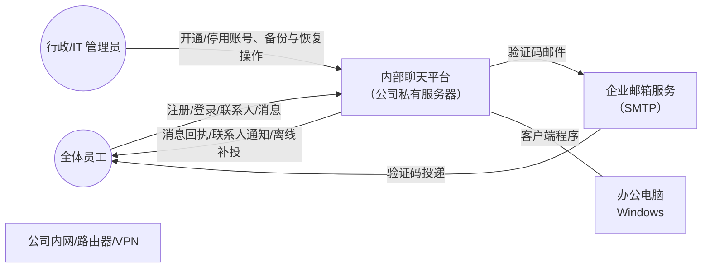
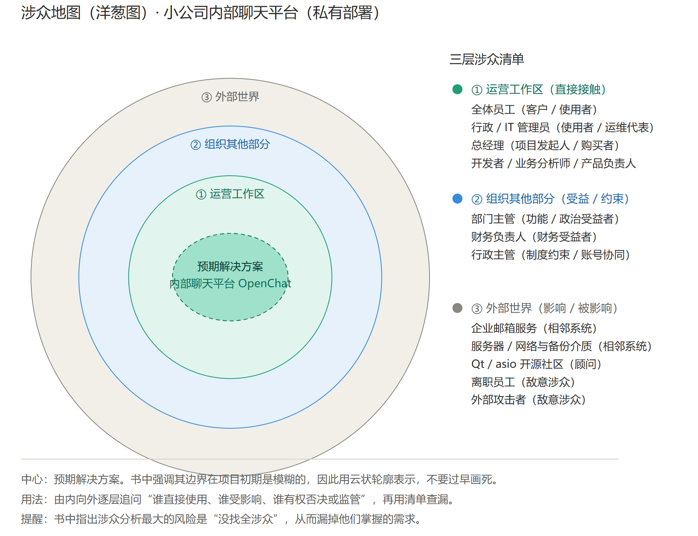
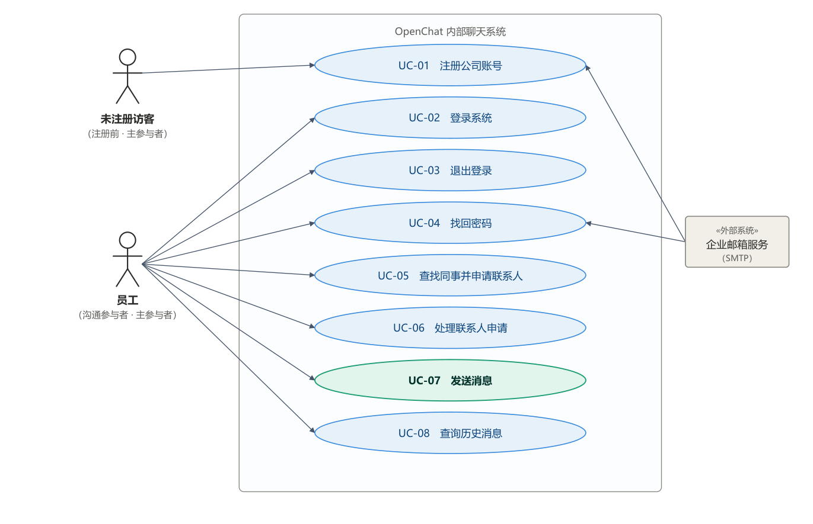
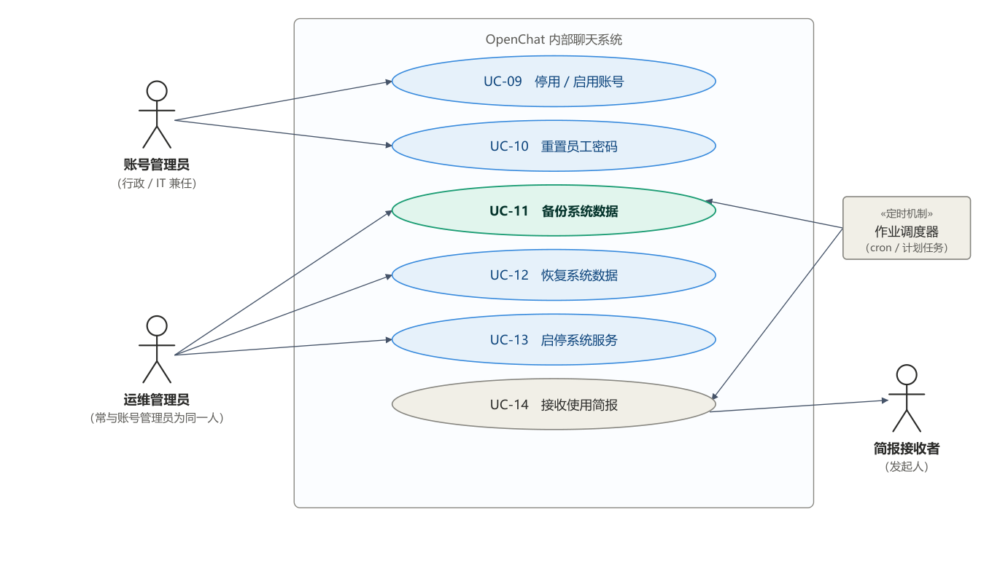
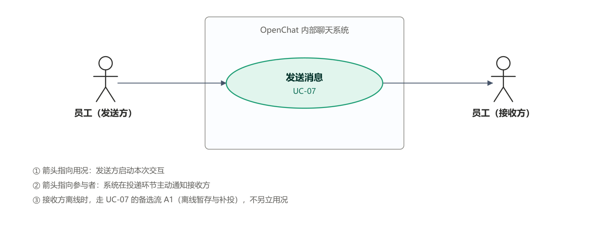

# OpenChat 小公司内部聊天系统 · 需求文档（V0.13）

> **项目名称**：OpenChat —— 小公司内部即时通讯系统（私有部署）
> **文档版本**：V0.13
> **编制日期**：2026-11-6
> **编制人**：余浩然、林健华、易俊辰
> **阅读提示**：本文档中标注 **〔待访谈校准〕** 的数字是编制时的假设值，必须在涉众访谈后替换为真实数据；标注 **〔差距〕** 的需求表示当前系统（现状系统 system-as-is）尚不具备，需要开发实现。
>
> **修订记录**
>
> | 版本         | 日期         | 变更                                                                                                      |
> | ---------- | ---------- | ------------------------------------------------------------------------------------------------------- |
> | V0.1       | 2026-10-29 | 初稿：问题、价值、目标、范围、涉众、客户细分、业务事件、优先级、功能与质量需求、差距与风险                                                           |
> | V0.11      | 2026-11-04 | 新增第 8 章"用况模型"（参与者、用况清单、用况图 3 张、5 个完整用况描述 + 9 个提纲、追溯与自查）；原第 8–13 章顺延为第 9–14 章                            |
> | V0.11（第二稿） | 2026-11-13 | 补写后台参与者的价值转写、子流示例、补充说明与特殊需求的分工、用况图类型对照、用况描述的写法约定                                                        |
> | V0.12      | 2026-11-18 | 重排第 8 章：系统边界扩为五节，参与者拆成"发现"与"编制文档"两节，用况同样拆分；补充设备、支持参与者、启停参与者、命名等判断依据                                     |
> | V0.12（第二稿） | 2026-11-18 | 补充业务用况与系统用况的区分（8.5.6，三张用况表随之改名）、合成与分解、环境图的用法、图不必反复修饰                                                    |
> | V0.13      | 2026-11-20 | 补充用况描述的写法约定（对话式与叙述式的取舍）；迭代计划与开发状态对齐                                                                     |
> | V0.13（第二稿） | 2026-11-20 | 统一主序号：第 2、11、12、13 章补齐节号（原无小节，目录里从"2"直接跳到"3.1"）；第 13 章拆为 13.1 风险与 13.2 开放问题；8.6 增加"节号↔用况号"对照表           |
> | V0.13（第三稿） | 2026-11-20 | 参与者具体化：新增 AC-00 未注册访客（只启动 UC-01），UC-01 后置条件写明 AC-00→AC-01 的转换；补写 UC-03 保留理由、UC-11/UC-12 分列理由；自查表加第 13 项 |
> | V0.13（第四稿） | 2026-11-20 | 删除建模工作会过程记录与用况生命周期两节；精简叙事性内容，统一行文风格                                                                     |
> | V0.13（第五稿） | 2026-11-20 | 新增第 14 章验收标准与需求追溯矩阵；验收用例编号采用 AT 系列，避免与参与者编号（AC）冲突；修正涉众登记表表头；全文小节统一编号                                    |
> | V0.13（第六稿） | 2026-11-20 | 摘要后新增术语表；补充验收用例 AT-11（历史消息查询），追溯矩阵 UC-08 行改挂 AT-11                                                      |

---

## 摘要

某 80 人规模的小公司〔待访谈校准〕目前靠员工个人的微信、QQ 和电话做内部沟通。报价、合同、财务、人事这类内容都经第三方平台流转，公司手里没有副本，也管不了留存；工作消息和私人消息混在同一个账号里；有人离职时，对接记录和账号权限都没法统一处置。钉钉、企业微信这类云协同工具能解决一部分问题，但数据存在第三方云上，按人头收费，对小公司来说既贵也不安心。

本项目的做法是在公司自己的服务器上部署一套内部聊天系统（基于 OpenChat 现有技术栈改造），一期只做一对一文字沟通，把"公私分开、数据留在自己手里、记录能查能交接"这三件事做实。

本文档从问题、价值、目标、范围写起，依次给出涉众分析、客户细分与业务事件，继而建立用况模型（第 8 章），最后给出 MVP 范围、功能与质量需求，以及现状系统与业务要求之间的差距。

---

## 术语表

**核心术语**

| 术语          | 全称 / 英文                         | 说明                                                 |
| ----------- | ------------------------------- | -------------------------------------------------- |
| 用况          | UC（Use Case）                    | 参与者为达成目标与系统之间的一次完整交互；本文档共 14 条（UC-01～UC-14）        |
| 参与者         | AC（Actor）                       | 系统之外与系统交换信息的角色，可以是人、外部系统或定时机制；共 7 个（AC-00～AC-06）   |
| 业务事件        | BE（Business Event）              | 外部世界发生、需要系统作出响应的事情；共 12 个（BE-01～BE-12）             |
| 业务用况        | BUC                             | 业务事件的处理过程（第 7 章用语），与第 8 章的系统用况（UC）不是同一概念，区分见 8.5.6 |
| 功能需求        | FR（Functional Requirement）      | 系统必须实现的功能点，共 20 条（FR-01～FR-20）                     |
| 质量需求        | NFR（Non-Functional Requirement） | 性能、可靠性、安全等非功能约束，共 10 条（NFR-01～NFR-10）              |
| 差距          | G（Gap）                          | 现状系统与业务要求之间的差距，共 10 条（G-1～G-10），见 10.2             |
| 验收用例        | AT（Acceptance Test case）        | 可执行验证的最小验收场景，共 11 条（AT-01～AT-11），见 14.1            |
| MVP         | Minimum Viable Product          | 最小可行产品：支撑衡量指标 M-1～M-6 达标的最小功能集合，见 9.2              |
| RPO         | Recovery Point Objective        | 恢复点目标：灾难发生后可容忍的最大数据丢失时间窗口（本文档要求 ≤ 24 h）            |
| RTO         | Recovery Time Objective         | 恢复时间目标：灾难发生后恢复服务所需时间的上限（本文档要求 ≤ 4 h）               |
| token       | —                               | 登录成功后签发的访问凭证，用于 TCP 长连接的二次鉴权                       |
| uid         | user id                         | 系统内用户的唯一标识                                         |
| ReqId       | Request Id                      | OpenChat 复刻版（llfcchat）通信协议中的请求编号，共 19 个            |
| 现状系统 / 待建系统 | as-is / to-be                   | 现有的复刻版系统 / 按业务要求建设后的目标系统                           |

**编号前缀约定**：P＝痛点，M＝衡量指标，SH＝涉众，BE＝业务事件，AC＝参与者，UC＝用况，FR＝功能需求，NFR＝质量需求，G＝差距，AT＝验收用例，C＝约束，A＝假设，R＝风险，Q＝开放问题。

---

## 1. 问题陈述（真实业务问题）

### 1.1 现状（As-Is）

公司约 80 人〔待访谈校准〕，内部工作沟通目前依赖：

- **员工个人微信 / QQ**：绝大多数日常沟通、文件互传、临时通知；
- **电话**：紧急事项；
- **邮件**：少量正式文件。

没有统一的内部沟通工具；人员、账号、记录分散在每名员工的个人设备与个人账号中。

### 1.2 痛点

| 编号  | 痛点            | 说明                                                                          |
| --- | ------------- | --------------------------------------------------------------------------- |
| P-1 | **敏感数据失控**    | 客户报价、合同条款、财务单据、人事事项经第三方平台（微信/QQ）流转，聊天记录存放在员工个人手机与第三方服务器上，公司既无副本也无处置权（保密性缺失） |
| P-2 | **离职无法回收**    | 员工离职后，与客户/同事的对接记录留在其个人微信中，无法移交；其个人账号仍可继续接收公司相关群消息                           |
| P-3 | **公私不分**      | 工作通知混入员工私人消息流，重要通知易被淹没；员工也被迫把私人微信交给同事和上级，缺乏边界                               |
| P-4 | **沟通无留痕**     | 口头承诺、需求变更、审批确认散落在各处聊天中，出现纠纷时无据可查                                            |
| P-5 | **商业替代方案不适配** | 钉钉/企业微信等云协同工具数据存于第三方云，组织架构、审批等能力按人头收费；对小公司而言既担心数据托管，又难以接受持续订阅成本             |

### 1.3 影响（待访谈校准）

以下为编制阶段掌握的初步信息（均待访谈校准）：

- 初步访谈中 6/8 名受访员工表示"工作沟通被迫使用个人微信"；
- 上一年度发生 2 起因员工离职导致客户对接记录无法移交的事件；
- 行政确认无法回答"公司现在有多少个工作群、群主是谁"。

### 1.4 不解决的后果

随人员规模增长，上述问题按人头线性放大：敏感信息泄露面扩大、离职交接成本上升、纠纷举证持续无据。问题不会自行消失，只会更贵。

### 1.5 一句话问题定义

> **公司的内部工作沟通发生在公司无法控制的渠道上，敏感信息、沟通记录与访问权限因此不可控、不可回收、不可追溯。**

---

## 2. 价值主张

### 2.1 价值接收者与价值

| 价值接收者       | 功能价值（能多做什么 / 少做什么）                           | 心理价值                      |
| ----------- | -------------------------------------------- | ------------------------- |
| 全体员工        | 有一个纯工作的沟通入口；消息不因对方离线而丢失（离线暂存后）；从个人微信中分离出工作关系 | 公私边界感；不用把私人微信交给同事；重要通知不淹没 |
| 部门主管        | 工作安排有统一出口，员工在电脑前即可响应；人员离职时下属对接记录可留存在系统内      | 对下属沟通有掌控感；减少"没收到消息"的扯皮    |
| 行政 / IT 管理员 | 账号集中开通与停用；数据备份在公司自己的设备上；故障排查不依赖外部客服          | 自主可控的踏实感；离职处置当天可完成        |
| 总经理（发起人）    | 敏感沟通数据留在公司控制范围内；零订阅费；人员流动风险可控                | 保密与合规的安心；对上/对外可说明数据治理方式   |
| 开发者（编制人）    | 真实业务场景驱动学习项目；每个业务事件都是可演示、可交付的成果              | 作品集价值；需求—开发—部署全流程实践       |

### 2.2 不解决的价值损失

P-1 至 P-5 持续存在，且每一次离职、每一次纠纷都会重新付费（时间与风险）。

---

## 3. 项目目标（Goal Statement）

### 3.1 目标陈述

- **Purpose（目的）**：让公司全部工作沟通发生在一个**仅运行于公司自有服务器**的内部渠道中，使工作沟通与个人生活分离，敏感沟通数据不出公司控制范围，人员离职时沟通记录与访问权限可统一处置。

- **Advantage（收益）**：

  - 相比个人微信/QQ：数据自主可控、账号可管理可停用、记录可留存可移交、公私分离；
  - 相比商业云协同工具：零订阅费、数据不托管给第三方、可按公司实际需要裁剪功能；
  - 相比现状（电话 + 个人微信）：消息有送达保障、有留痕、有统一入口。

- **Measurement（衡量指标）**：

  | 编号  | 指标                        | 目标值     |
  | --- | ------------------------- | ------- |
  | M-1 | 上线 3 个月内周活跃员工占全员比例        | ≥ 80%   |
  | M-2 | 抽查敏感沟通（报价/合同/财务）经由内部渠道的比例 | ≥ 90%   |
  | M-3 | 消息投递成功率（含离线暂存后补投递）        | ≥ 99.9% |
  | M-4 | 离职员工账号当日停用率               | 100%    |
  | M-5 | 工作时间（工作日 8:30–18:30）系统可用率 | ≥ 99%   |
  | M-6 | 员工季度满意度问卷                 | ≥ 4 / 5 |

### 3.2 可实现性检查

| 约束                                            | 评估            |
| --------------------------------------------- | ------------- |
| 服务器：公司自有/托管服务器 1 台（4 核 8 GB 量级即可支撑 100 人以下规模） | 可实现           |
| 运维：无专职运维，由行政/IT 兼任，运维操作必须傻瓜化（脚本化备份、一键启动）      | 需按此约束设计       |
| 开发资源：开发者 3人（业余时间），进行openchat开发                | 决定了 MVP 必须小   |
| 外部依赖：注册/找回密码依赖邮件验证码，需要可用的企业邮箱 SMTP            | 部署前提，需行政确认    |
| 群聊能力：当前系统不具备（见 10.2 差距 G-4），而小公司场景大概率需要，后续实现  | 最大风险项，见第 13 章 |

---

## 4. 范围（Scope）

### 4.1 Context 图（上下文图）



**相邻系统说明**：

| 相邻系统          | 交互内容                       | 控制权              |
| ------------- | -------------------------- | ---------------- |
| 企业邮箱服务        | 系统发出验证码/通知邮件 → 员工收信        | 不可控（可更换供应商），影响轻微 |
| 公司内网/VPN      | 承载客户端与服务端的连通性；远程办公经 VPN 接入 | 公司可控             |
| 办公电脑（Windows） | 运行客户端程序                    | 公司可控             |

> 数据守恒：所有从系统流出的数据（备份文件、验证码邮件、补投递消息）都有对应的输入来源，检查表见 7.3。

### 4.2 授权改变区域与影响区域

- **授权改变区域（Charter to Change）**：公司内部工作沟通的方式——员工从此用内部平台进行工作沟通；行政/IT 的账号与备份操作方式。
- **影响区域（Zone of Influence）**：员工的个人沟通习惯（公司不能命令员工删除微信，只能靠"工作沟通必须走内部渠道"的制度 + 更好用的产品去影响）；邮件服务商（可议价更换，影响轻微）。

### 4.3 范围清单

**In Scope**

- 一对一文本消息（在线实时 + 离线暂存补投递）
- 联系人（好友）管理：搜索、申请、认证、列表
- 账号生命周期：邮箱验证码注册（限公司邮箱域）、登录、找回密码、管理员停用/启用
- 消息记录留存与本人查询
- 每日自动备份与恢复预案
- Windows /Linux跨平台桌面客户端

**Out of Scope**

| 排除项          | 理由                                        |
| ------------ | ----------------------------------------- |
| 群聊           | 当前系统不具备；小公司场景大概率刚需 → 列为二期首选，见第 13 章风险 R-1 |
| 文件/图片传输      | 当前系统不具备；涉密文件恰是用户最不想走微信的内容 → 二期，风险 R-2     |
| 音视频通话        | 成本高，非核心痛点，列入后续候选，暂不排期                     |
| 移动端 App      | 一期以桌面办公场景为主，移动端列入后续候选                     |
| 已读回执、消息撤回    | 体验增强项，非 MVP；涉及隐私边界（NFR-07、R-4），是否实现待评审决策  |
| 对接考勤/OA/审批系统 | 小公司暂无此系统，属范围外（不考虑）                        |

---

## 5. 涉众分析

> 洋葱图三层同心，中心是预期解决方案（这时边界还模糊），往外依次是运营工作区、组织其他部分、外部世界。

### 5.1 洋葱图



- **中心**：内部聊天平台 OpenChat（云状，边界待定）
- **① 运营工作区**：全体员工、行政/IT 管理员、总经理（发起人）、开发者/业务分析师
- **② 组织其他部分**：部门主管、财务负责人、行政主管
- **③ 外部世界**：企业邮箱服务、服务器/网络与备份介质、开源社区（Qt/asio）、离职员工、外部攻击者

### 5.2 涉众登记表

| 编号    | 涉众            | 所属层 | 角色类型                                    | 关注点              | 影响力    | 参与方式      | 主要需求来源          |
| ----- | ------------- | --- | --------------------------------------- | ---------------- | ------ | --------- | --------------- |
| SH-01 | 全体员工          | 运营区 | Customer as User                        | 好用、消息不丢、公私分离     | 中      | 访谈、试用反馈   | 日常沟通场景          |
| SH-02 | 行政/IT 管理员     | 运营区 | Customer as User + 相邻系统代表（运维）           | 部署简单、备份可靠、离职当天停用 | 高      | 深度访谈      | 账号与运维流程         |
| SH-03 | 总经理           | 运营区 | Project Sponsor + Customer as Purchaser | 保密性、零订阅费、人员流动风控  | 高（拍板人） | 立项评审      | 目标与衡量指标 M-1~M-6 |
| SH-04 | 开发者（编制人）      | 运营区 | BA / Product Owner / 架构师                | 需求明确、范围可控、可交付    | 高      | 全程        | 本文档             |
| SH-05 | 部门主管          | 组织层 | 功能/政治受益者                                | 下属响应及时、离职留痕      | 中高     | 访谈        | 通知下达、跨人沟通       |
| SH-06 | 财务负责人         | 组织层 | Financial Beneficiary                   | 零订阅费、预算内         | 中      | 预算确认      | 成本约束            |
| SH-07 | 行政主管          | 组织层 | 功能受益者 / 制度约束                            | 入离职流程衔接、制度配套     | 中      | 访谈        | 账号生命周期规则        |
| SH-08 | 企业邮箱服务        | 外部层 | 相邻系统                                    | 邮件送达率、发信限额       | 中      | 接口文档/配额确认 | 验证码邮件           |
| SH-09 | 服务器/网络/备份介质   | 外部层 | 相邻系统                                    | 稳定性、带宽、备份可靠性     | 中      | 运维预案      | 部署约束            |
| SH-10 | 开源社区（Qt/asio） | 外部层 | 顾问（知识来源）                                | 版本兼容、安全补丁        | 低      | 文档/社区     | 技术约束            |
| SH-11 | 离职员工          | 外部层 | Hostile Stakeholder                     | 离职后仍想拿走记录/继续访问   | 中      | 威胁建模      | 停用即失效、数据回收      |
| SH-12 | 外部攻击者         | 外部层 | Hostile Stakeholder                     | 窃取通信内容、爆破账号      | 中      | 威胁建模      | 密码哈希、TLS、token  |

---

## 6. 客户细分与画像

> 客户细分按"要完成的业务问题"来分，不按部门或职级分；分完再建画像，最后排优先级。

### 6.1 客户细分

| 客户群体              | 特征与场景                             | 核心诉求                    | 优先级 |
| ----------------- | --------------------------------- | ----------------------- | --- |
| 一线业务员工（销售/客服/采购）  | 对外沟通多，报价/合同等敏感内容高频；手机微信里客户与家人混在一起 | 敏感沟通走公司渠道；电脑端专注沟通       | P0  |
| 技术/后台员工（研发/财务/行政） | 整日在电脑前，双屏办公                       | 桌面端常驻、消息可靠送达、不被私人消息打断   | P0  |
| 管理者（部门主管及以上）      | 一对多沟通多，希望拉群；需要确认下属收到              | 群聊（当前缺失，见差距 G-4）；消息触达确认 | P1  |
| 行政/IT 管理员         | 兼职运维，不懂代码                         | 部署/备份/停用操作简单可靠          | P0  |

### 6.2 客户画像（Persona）

**画像一：小周（销售，26 岁）**

- 场景：给客户发报价前，习惯先在微信里和主管确认；报价单曾发错过群。
- 痛点：工作消息混在 200+ 个微信会话里；离职交接时微信记录带不走也留不下。
- 成功标准：报价沟通全程在公司渠道；半年后离职的同事，其客户对接记录主管还能查到。

**画像二：老李（研发主管，38 岁）**

- 场景：同时带 5 个下属，同一件事要对 5 个人说 5 遍。
- 痛点：系统没有群聊，只能挨个发（暴露需求冲突：他的最高诉求落在二期范围）。
- 成功标准：一条通知发出去，系统告诉他"谁没收到"。

**画像三：张姐（行政兼 IT，31 岁）**

- 场景：每月 1–2 人入职、离职；公司只有她"懂点电脑"。
- 痛点：现在的微信工作群她管不了；一旦系统出问题她无法求助。
- 成功标准：新员工 10 分钟内用公司邮箱注册成功；离职当天点一下"停用"，对方立即登录不上去；备份每周自动落盘，她看得懂备份日志。

### 6.3 优先级说明

一线业务员工与行政/IT 管理员构成 P0：前者决定系统"有没有人用"（M-1），后者决定系统"能不能活下来"（备份与账号处置）。管理者群体 P1——其核心诉求（群聊）依赖二期能力，一期以"消息触达确认"部分缓解。

---

## 7. 业务事件（Business Events）

> 业务事件是外部世界发生了、需要系统作出响应的事情，分人触发、时间触发、条件触发三类。每个事件的响应就是一个业务用况（BUC）。

### 7.1 业务事件清单

| 编号    | 业务事件           | 类型       | 触发者       | 触发数据           | 系统响应（BUC 概要）                                                       | 输出         | 数据存储                |
| ----- | -------------- | -------- | --------- | -------------- | ------------------------------------------------------------------ | ---------- | ------------------- |
| BE-01 | 新员工申请开通账号      | 业务用况     | 新员工       | 公司邮箱地址         | 校验邮箱域名白名单 → 生成验证码（有效期 300s）→ 发送邮件 → 校验注册信息 → 创建账号并分配 uid           | 验证码邮件、注册结果 | user、uid 分配器        |
| BE-02 | 员工登录           | 业务用况     | 员工        | 邮箱 + 密码        | 两步验证：网关校验密码 → 状态服务分配聊天服务器并签发 token → 客户端建立长连接二次鉴权 → 拉取资料/联系人/申请    | 登录结果、在线状态  | token（Redis）、连接数    |
| BE-03 | 员工忘记密码         | 业务用况     | 员工        | 邮箱 + 验证码 + 新密码 | 校验验证码与账号匹配 → 更新密码（哈希存储）                                            | 重置结果       | user                |
| BE-04 | 员工搜索同事并发起联系人申请 | 业务用况     | 员工        | uid 或用户名、附言    | 查询目标用户 → 写入申请记录（待处理）→ 对方在线则实时推送                                    | 申请通知       | friend_apply        |
| BE-05 | 对方处理联系人申请      | 业务用况     | 员工        | 申请记录、同意/拒绝     | 同意则建立双向联系人关系；通知双方                                                  | 认证结果通知     | friend、friend_apply |
| BE-06 | 员工发送消息         | 业务用况     | 员工        | 目标 uid、文本内容    | 先向发送方回执 → 查询接收方所在服务器 → 同服直推 / 跨服 RPC 转发 → 在线投递；**离线则暂存，待上线补投**〔差距〕 | 送达回执、消息    | 消息记录表〔新增〕           |
| BE-07 | 员工退出登录         | 业务用况     | 员工        | 下线请求           | 断开长连接、释放会话、更新在线连接数                                                 | —          | 连接数（Redis）          |
| BE-08 | 验证码到达有效期终点     | 时间/条件触发  | 系统        | 300 秒计时        | 验证码失效，需重新申请                                                        | —          | code_<email> 过期删除   |
| BE-09 | 到了每日备份的时间      | 时间触发     | 系统        | 凌晨 2:00        | 导出 MySQL 全量 + Redis 快照 → 压缩加密 → 写入备份存储 → 校验并记录备份日志                 | 备份文件、备份日志  | 备份存储                |
| BE-10 | 员工离职，管理员停用账号   | 业务用况     | 行政/IT 管理员 | 目标 uid         | 立即断开会话 → 标记账号停用（禁止登录）→ 记录处置信息；其消息记录按留存策略保留〔差距〕                     | 停用确认       | user（状态位）、处置日志      |
| BE-11 | 消息发出后接收方长时间离线  | 条件触发     | 系统        | 投递未成功计时        | 消息转入离线暂存队列并标记"未送达"，接收方上线后按序补投〔差距〕                                  | 未送达标记、补投递  | 离线消息表               |
| BE-12 | 到了生成使用简报的时间    | 时间触发（P2） | 系统        | 每周一 9:00       | 汇总上周活跃人数、消息量，发送给发起人                                                | 使用简报       | 统计表                 |

### 7.2 业务用况的验收视角简写

> 说明：本节为验收用的"给定—当—则"简写，完整规约（前置条件、后置条件、基本流、备选流）见 8.6.8（UC-07）和 8.6.9（UC-09），两者若有出入，以 8.6 为准。这里的"业务用况（BUC）"指业务事件的处理过程，与第 8 章的系统用况不是同一概念，区分见 8.5.6。

**BUC-06 员工发送消息（含离线场景）→ UC-07**

```
Given 员工 A 已登录且与 B 已建立联系人关系
When  A 发送一条文本消息给 B
Then  系统在 300 ms 内（局域网）向 A 回执
      若 B 在线：B 在 1 秒内收到消息
      若 B 离线：消息进入离线暂存并标记未送达；
                B 在下次登录后 5 秒内按序收到全部暂存消息
且    该消息写入消息记录表（留存与查询依据）
```

**BUC-10 管理员停用离职员工账号 → UC-09**

```
Given 张姐（行政/IT）具有管理员权限
When  张姐对 uid=X 执行"停用"
Then  系统立即断开 X 的在线会话
      X 再次登录被拒绝并提示"账号已停用"
      停用操作记录操作人、时间，供审计
且    X 的历史消息记录不被删除（按留存策略归档）
```

### 7.3 数据守恒检查

| 输出              | 输入来源                    | 检查结果                                      |
| --------------- | ----------------------- | ----------------------------------------- |
| 离线补投递的消息        | BE-06 发送的消息内容           | 有来源，但前提是消息必须落库，由此引出差距 G-1                 |
| 每日备份文件          | BE-01/02/04/05/06 写入的数据 | 有来源                                       |
| 使用简报（BE-12）     | 在线连接数、消息记录              | 有来源                                       |
| 当前系统的"消息记录查询"能力 | 无消息收发与存储层，无输入来源         | **缺口**。必须新增消息收发与存储，否则留痕、补投、审计、简报这些输出都无从谈起 |

---

## 8. 用况模型（Use-Case Model）

本章建立 OpenChat 的系统用况模型，组织如下：8.1 给出全章的建模约定；8.2 界定系统边界并给出参与者判定结论；8.3 说明参与者的发现；8.4 编制参与者文档（登记表、特征、追踪与后台参与者的价值转写）；8.5 从参与者目标发现用况并给出 14 条用况清单；8.6 编制用况文档（用况图、描述模板、5 条完整描述与 9 条提纲）；8.7～8.9 给出追溯、模型自查与补充说明。

### 8.1 建模约定

- 用况描述的是参与者为了达成某个目标，和系统之间发生的一次完整交互。它不是功能点，也不是菜单项。所以"获取验证码"没有单独成条——它自己不产生价值，只是 UC-01 里的几步。
- 用况必须由参与者启动，并且至少给一个参与者带来能说清楚的价值。UC-01 的价值是"我拿到了一个能登录的公司账号"，不是"系统生成了一个 uid"。
- 用况之间是独立的，不用 include 和 extend：一个用况不调用另一个用况，也不和另一个用况交互，共用的片段写成子流。所以"登录"不作为各用况的 include，而写成前置条件。
- 设备不是参与者。
- 定时触发的用况，启动者写"作业调度器"，不写"系统时钟"。
- 用况名用主动动宾短语，写"发送消息"，不写"消息发送"。
- 每条用况都要有前置条件、后置条件、基本流和备选流，基本流控制在 5 到 10 步。

以上约定使本章用况描述一般不出现"数据库""缓存"等具体技术组件。例外有两处：UC-02 的登录包含密码校验与在线连接建立两次验证，是本项目"能登进去但收不到消息"问题的根源，压缩成一句"用户登录"会掩盖该问题；UC-11～UC-13 的运维用况操作对象本身就是这些组件，写虚了无法照做。其余业务用况一律停在行为层面。

### 8.2 系统边界

#### 8.2.1 边界划分的依据

GateServer、VerifyServer、聊天服务器由本项目自行开发、部署和维护，属于系统内部组成部分，不划为外部系统；企业邮箱服务不由本项目控制，其可用性、限流与投递行为均无法干预，应划在边界之外。第 4 章的 Context 图即按此原则列全了外部实体：企业邮箱服务、公司内网、办公电脑。

#### 8.2.2 边界划分的标准

判断标准：对另一系统的行为是否有控制权；没有控制权的，通常就是参与者。以此判定：

| 外部对象        | 判定理由                           | 结论    |
| ----------- | ------------------------------ | ----- |
| 企业邮箱服务      | 它不可用时，注册和找回密码都无法完成，系统无法自行投递验证码 | 是参与者  |
| MySQL、Redis | 用哪个数据库、要不要加缓存由本项目决定，更换后系统行为不变  | 不是参与者 |
| 短信服务（将来可能加） | 一旦接入即为外部系统，需单独建立用况             | 二期再议  |

这条标准同时把"要不要用 Redis"一类技术讨论排除在需求文档之外。

#### 8.2.3 反查：系统所需信息的来源

从"系统处理一件事需要哪些信息、这些信息是否由系统自持"的角度反查参与者：

- **注册**：判断"邮箱是否属于公司"的信息有两处来源——邮箱域白名单（人填写的配置项，不是外部实体，作为 UC-01 的前置条件）与企业邮箱服务（不可控外部，为参与者）。
- **备份**："每日几点开始备份"来自公司规定，写成配置；驱动作业执行的是定时机制，即作业调度器。
- **发消息**："对方是否在线"由系统自身的连接状态表维护，不需要外部提供，不产生新参与者。

#### 8.2.4 参与者判定结论

下面这张表是逐项判定的结论，供后续评审直接引用，避免重复讨论。

| 候选对象                              | 算不算参与者    | 为什么                                                 |
| --------------------------------- | --------- | --------------------------------------------------- |
| 办公电脑 / Windows 客户端                | 不算（设备）    | 它只是员工和系统之间的通道；将来改出网页版，员工仍是同一个参与者                    |
| 打印机（将来要打印聊天记录时）                   | 不算（设备）    | 打印只是信息送达的一种方式，用况关心的是系统如何汇总信息，而非输出介质                 |
| MySQL / Redis / 备份存储              | 不算（设计选择）  | 选用与更换由本项目决定，换一套实现系统行为不变                             |
| GateServer / VerifyServer / 聊天服务器 | 不算（边界内）   | 由本项目自行开发和部署，属系统内部结构。把它们画到边界外，用况图会变成部署图              |
| 操作系统、编程语言、Qt 版本                   | 不算（约束）    | 记录在第 12 章 C-3、C-4，追踪到受影响的用况，但不进用况图                  |
| 邮箱域名白名单                           | 不算（配置）    | 它是人填进去的一条规则，不是会自己行动的外部实体。写进 UC-01 的前置条件             |
| 企业邮箱服务（SMTP）                      | 算（外部系统）   | 不可控的外部系统，不可用时 UC-01 必须终止                            |
| 作业调度器                             | 算（定时机制）   | 备份和简报由它触发；相比"系统时钟"，它同时要求明确的启动规则和作业状态日志              |
| 离职员工                              | 不算（敌对涉众）  | 离职后不再和系统交互。"还想继续访问"是威胁，不是角色，由 UC-09 的后置条件和 NFR-06 管 |
| 部门主管 / 总经理（作为使用者）                 | 不算（被员工覆盖） | 他们登录后扮演的就是"员工"，职位不是参与者                              |
| 外部客户                              | 不算（一期范围外） | 见开放问题 Q-1。真要做外部沟通，那是另一个系统                           |

#### 8.2.5 边界外内容的归属

落在边界外的东西去了三个地方：

- 硬约束（单台服务器、无专职运维、只能跑 Windows 客户端）→ 第 12 章，并追踪到受影响的用况；
- 技术选型（Qt、Boost、Node.js、MySQL）→ 第 10 章的说明和第 12 章 C-4，不进用况图；
- 纯实现细节（用不用连接池、日志怎么切分）→ 不写进需求文档，留给设计阶段。

这么分的好处是，用况图里只剩"谁要什么"，评审的时候不会被技术细节带跑。

### 8.3 参与者的发现

#### 8.3.1 主参与者

主参与者是"缺少了他们系统就没有存在意义"的角色。本项目的主参与者是员工；其余参与者的用况在员工用况确立之后逐步补全。

#### 8.3.2 用户类型与参与者的对应

第 6 章的四类客户按"人的特征"划分，参与者按"目标"划分，两者不是一对一：

- 前三类（一线业务员工、技术/后台员工、管理者）的目标相同——与同事沟通工作事项，合并为 AC-01 员工；
- 第四类（行政/IT 管理员）拆分为 AC-02 账号管理员与 AC-03 运维管理员：前者管账号生命周期，后者管服务与数据，两个目标各自需要独立的用况。

本项目用户类型与参与者为 4 对 3 的对应关系。

#### 8.3.3 参与者与画像的对应

参与者从第 6 章的三个画像推出：小周（销售）与老李（研发主管）对应 AC-01 员工；张姐（行政兼 IT）同时承担账号与运维两类职责，对应 AC-02 与 AC-03 两个参与者。这也印证了参与者与职位不是一一对应。

注：老李"一条通知发给 5 个人"的诉求落在范围外（群聊，见第 13 章 R-1）。一期不做群聊，该诉求由 R-1 跟踪。

#### 8.3.4 支持参与者

除主参与者外，部分参与者不启动用况，但为其提供信息或承担关键后果，最容易被遗漏。AC-02 与 AC-03 即属此类：他们不启动 UC-07，但账号的开通与停用能力是发起人最关注的需求，因此在本项目的优先级上为 P0。

#### 8.3.5 定时作业的启动者

备份等定时作业的启动者是作业调度器，而非"系统时钟"：调度器既明确作业的启动规则，也要求保留作业状态日志以供核查。备份脚本为本项目自行开发（FR-17），备份内容、校验方式与保留份数均由本项目决定，因此 UC-11 需要建模；若未来改用现成的自动快照方案，UC-11 可从模型中移除，仅在约束中保留"每日备份"。参与者不是越多越好：每多一个参与者，就多一组用况要维护。

#### 8.3.6 参与者不一定是人

参与者不限于人：系统之外的任何实体，只要与系统交换信息，就可以是参与者。本项目中的企业邮箱服务（AC-04）即属此类——系统把验证码交由它投递，它再把邮件送到员工手上；它没有界面，也不会提需求，但缺少它 UC-01 无法完成。

#### 8.3.7 设备不是参与者

设备不是参与者：客户端只是员工与系统之间的通道，参与者是员工本人。把客户端从图里移除、让员工直接关联用况还有一层好处——将来新增网页版或移动端，用况模型无需改动。

#### 8.3.8 参与者与用况的迭代发现

参与者和用况不是一次找全的，而是互相带出的三轮迭代：第一轮从员工目标得出注册、登录、查找同事、发消息、查历史等核心用况，同时发现缺少离职处置角色；第二轮补充账号管理员，带出 UC-09、UC-10；第三轮为备份作业补充作业调度器，确立 UC-11 与 UC-14。

### 8.4 为参与者编制文档

找到参与者之后，还需明确命名、描述与完整性检查的约定。

#### 8.4.1 命名：写角色，别写职位

参与者名应描述角色职责而非组织岗位：岗位要做的远不止一件事，一条用况装不下。自查发现 AC-02"账号管理员"、AC-03"运维管理员"名称偏岗位化，但公司内确实由"行政/IT"一个岗位兼任这两类职责；经权衡保留名称，在登记表的描述中写明职责范围，并注明两者常由同一人承担。名字像岗位可以接受，关键是职责描述与岗位说明不要混淆。

#### 8.4.2 避免过度一般化

参与者的抽象程度要适度：若全部归并为一个笼统的"用户"，模型将无法说明不同角色使用系统的目的。本项目员工与管理员的目标差异显著——一个要"把话说出去"，一个要"把人挡在外面"——无法用同一条用况讲完，必须分列。

#### 8.4.3 避免从用况名反推参与者名

参与者名不应从用况名反推（如由"发送消息"推出"消息发送者"）。曾拟将 AC-01 命名为"消息发送者"，但接收方也是员工，且员工还需登录、查找同事、查询历史，"发送者"一词覆盖不了这些用况，故定名"员工"；注册用况单独挂在 AC-00 上，理由见 8.4.4。

#### 8.4.4 参与者登记表

| 编号    | 参与者    | 类型                | 职责与目标                                                  | 规模 / 使用频率                  | 关联用况              | 涉众追溯        |
| ----- | ------ | ----------------- | ------------------------------------------------------ | -------------------------- | ----------------- | ----------- |
| AC-00 | 未注册访客  | 主参与者（AC-01 的前置状态） | 还没有系统账号的新同事。目标：凭公司邮箱自助开通一个账号，不用等管理员手工建号。注册成功后转为 AC-01。 | 随入离职发生，每月 1–2 人            | UC-01             | SH-01、SH-02 |
| AC-01 | 员工     | 主参与者              | 在公司内部就工作事项与同事一对一沟通的人。目标：找到该找的人、把话说清楚、事后查得回来。           | 约 80 人；工作日 8:30–18:30 常驻在线 | UC-02 ~ UC-08     | SH-01、SH-05 |
| AC-02 | 账号管理员  | 支持参与者（本项目 P0）     | 管账号生命周期的人，通常由行政/IT 兼任。目标：入职当天能开通、离职当天能切断、密码问题能兜底。      | 1–2 人；每月 1–2 次入离职          | UC-09、UC-10       | SH-02、SH-07 |
| AC-03 | 运维管理员  | 支持参与者             | 管服务器、备份和恢复的人，常与 AC-02 是同一个人。目标：系统挂了能拉起来，数据丢了能恢复。       | 1 人；每周巡检，故障时使用             | UC-11、UC-12、UC-13 | SH-02、SH-09 |
| AC-04 | 企业邮箱服务 | 支持参与者（外部系统）       | 承担验证码邮件投递的外部系统。目标很简单：把邮件送到。系统控制不了它的可用性。                | 第三方；每次注册/找回触发              | UC-01、UC-04       | SH-08       |
| AC-05 | 作业调度器  | 支持参与者（定时机制）       | 到点启动作业的机制（cron 或 Windows 计划任务）。目标：按时触发，并且留下执行状态。       | 每日 1 次、每周 1 次              | UC-11、UC-14       | SH-02       |
| AC-06 | 简报接收者  | 支持参与者（受益）         | 每周收使用简报的决策者。目标：判断系统到底有没有人用（M-1）。                       | 1 人；每周一次                   | UC-14             | SH-03       |

登记表中"职责与目标"一列描述的是参与者使用系统要达到的目的，而非岗位工作说明——描述若读起来像岗位说明书，即为写偏。

**为什么单列一个 AC-00，而不是笼统叫"用户"。** 第一版登记表里只有 AC-01 员工，注册这条用况的主参与者写的也是"员工"。评审时被指出一处别扭：注册那一刻，这个人还没有账号，系统里查不到他，把他叫"员工"是拿他入职后的身份描述他当下的状态。同理，只写"用户"更糟——"用户"既不说明他有没有账号，也不说明他能做什么，等于把六个角色的差别全抹平了。

所以按"有无账号"这个最硬的区别，把注册前后的两种身份分开：

- **AC-00 未注册访客**：没有账号，只能启动 UC-01。它的目标只有一个——把账号拿到手。
- **AC-01 员工**：有账号且状态为启用，能启动 UC-02 到 UC-08。

两者不是两个人，是同一个人的两个阶段。UC-01 的后置条件里写着这次转换：注册成功即由 AC-00 转为 AC-01。这样写的好处是，"谁能做什么"在模型里是查得到的，而不是靠读者自己补。

**UC-04 找回密码为什么不归 AC-00。** 找回密码要求账号已经存在（备选流 A1 正是"邮箱未注册"的拒绝路径），所以它的主参与者仍是 AC-01——一个已注册但登不进来的员工。按状态切分角色，边界要卡在"账号存不存在"，不能卡在"有没有登录"。

#### 8.4.5 参与者特征

影响界面设计的参与者特征包括使用环境、人数与频率、领域知识、计算机经验及常用软件等。其中"常用软件"为界面设计提供直接参照：员工端沿用微信的会话列表心智模型，管理端采用表格筛选形式而非命令行。

| 参与者          | 使用环境                 | 人数 / 频率       | 领域知识         | 计算机经验 | 常用的其他软件（可借鉴的概念） | 对设计的约束                                |
| ------------ | -------------------- | ------------- | ------------ | ----- | --------------- | ------------------------------------- |
| AC-01 员工     | 办公室工位，双屏，常被电话和当面沟通打断 | 80 人 / 每天     | 熟悉业务，不懂技术    | 中到高   | 微信、QQ           | 交互必须"不用学"：沿用会话列表加聊天窗口的心智模型（NFR-08）    |
| AC-02 账号管理员  | 行政工位，非技术岗            | 1–2 人 / 每月几次  | 懂入离职流程，不懂数据库 | 低到中   | Excel、公司邮箱      | 停用操作一步可达，要确认加原因；不暴露 SQL 和命令行          |
| AC-03 运维管理员  | 服务器远程终端              | 1 人 / 每周巡检    | 懂基础 Linux 运维 | 中     | SSH、cron        | 全部操作为脚本：一键启停、一键备份、一键恢复，日志要能看懂（NFR-09） |
| AC-04 企业邮箱服务 | 无界面                  | 第三方 / 每次注册    | —            | —     | —               | 需要 SMTP 账号和发信配额（C-2）；失败要给出能判读的错误      |
| AC-05 作业调度器  | 系统计划任务               | 每日 1 次、每周 1 次 | —            | —     | crontab         | 要有作业状态日志，能回答"昨晚的备份到底跑没跑"              |
| AC-06 简报接收者  | 手机、邮件                | 1 人 / 每周      | 关注结论不关注明细    | 中     | 邮件客户端           | 简报只给结论和趋势，不给原始数据表                     |

#### 8.4.6 用户类型与涉众的双向追踪

对用户类型与涉众做双向检查：

**从用户类型往参与者查**。6.1 的四类客户，前三类被 AC-01 覆盖，第四类拆成 AC-02 和 AC-03。四类都有人接，没有漏。如果哪一类没人接，要么它其实不是系统用户，要么还漏了一个参与者。

**从参与者往用户类型查**。七个参与者里，AC-00 到 AC-06 都能追到具体的人或系统，没有凭空冒出来的。其中 AC-00 是唯一的"状态型参与者"——它不是新的人群，而是 AC-01 的前置状态：同一个人，注册前叫未注册访客，注册后叫员工。这类参与者不必对应客户细分，判断标准是它有没有独立的目标（拿到账号）和独立的启动权（只有它能启动 UC-01）。如果有参与者既追不到用户类型、又说不清自己的目标，那它多半是多余的。

**再往涉众查**。AC-00 到 AC-06 能对上 SH-01 到 SH-09。SH-11（离职员工）和 SH-12（外部攻击者）对不上——因为他们压根不是参与者，理由在 8.2.4 说过。

该检查还拦下了一处冗余：曾拟设置"总经理"参与者（理由是"要看简报"），但其登录系统时扮演的就是员工，查看简报的需求已由 AC-06 表达，故取消。

#### 8.4.7 后台参与者的价值转写

后台参与者不启动用况，只被系统调用或在旁提供信息，其价值需转写为用况的业务规则、前置条件，或单独写成质量需求。AC-04 与 AC-05 属于后台参与者，出现在用况图中是正确的（系统确实要与它们通信），但其价值须落到以下位置：

| 后台参与者        | 它的价值          | 转写到哪                                                                                       |
| ------------ | ------------- | ------------------------------------------------------------------------------------------ |
| AC-04 企业邮箱服务 | 验证码邮件按时送到员工手上 | 能不能送达取决于 SMTP 是否可用，写成 UC-01 的前置条件；发不出去的情况写成 UC-01 备选流 A6；"邮件到得慢就注册不完"体现在 NFR-08 的 10 分钟指标上 |
| AC-05 作业调度器  | 作业按时启动，事后能查   | "每天 02:00 启动"是业务规则，写在 UC-11 基本流第 1 步；存储空间和依赖服务状态写成 UC-11 的前置条件；作业日志可读写成 NFR-09             |

AC-06 简报接收者不算后台参与者。他不启动用况，但有明确目标（判断系统有没有人用），是受益方，所以按正常参与者处理。

### 8.5 发现用况

参与者确定之后，用况从他们的目标推出：参与者真正想用系统做成什么。

#### 8.5.1 候选用况的列出与合并

先不加筛选地列出候选用况，再逐条合并。第一版共 18 条：注册、登录、登出、找回密码、搜索同事、申请好友、同意好友、拒绝好友、发消息、收消息、看历史、停用、启用、重置密码、备份、恢复、启停服务、发简报。

合并规则：收消息是发消息的另一半，属同一次交互的两个方向，不独立成条；同意与拒绝合并为"处理联系人申请"，是同一决定的两个结果；停用与启用合并为一条，是同一开关的两个方向。合并后为 14 条。

#### 8.5.2 用况不是功能

把系统按协议拆开（llfcchat 的 19 个 ReqId：验证码、注册、重置密码、登录、聊天登录、搜索用户、申请好友、认证好友、文本消息……）逐条建用况，得到的是 19 个功能块，而不是用况模型。

正确的做法是先问每个 ReqId 服务的是谁的目标：搜索和申请服务的是同一个目标——找到某个同事并建立联系，合成 UC-05；申请的发起和处理分属两个人、两个目标，拆成 UC-05 和 UC-06；验证码谁也服务不了，只是注册过程中的两步，收进 UC-01。

"在只有一件有用的事情可以做的地方，就只有一个用况"；反之，一件事若拆成三段各自都不能单独完成，那它就是一条用况里的三步。分解的界限：把系统功能分解到"对某个涉众有价值"这一层为止——拆到"发消息"为止，再往下拆成"输入文字""点发送""写进库"就属于设计与实现，不再是用况。

#### 8.5.3 用况的粒度下限

粒度的下限是"独立价值"：一个交互片段若不能独立产出对参与者有价值的结果，就不构成用况。以"获取验证码"为例——验证码收到了，但注册尚未完成，什么也做不了，因此它只是 UC-01 基本流中的一步，不单独成条。

同一把尺子还砍掉了两个候选："查看联系人列表"是发消息的入口，"搜索用户"是申请联系人的一步，各自都不产生独立价值。

**留下 UC-03 的理由。** 退出登录是清单里最容易被质疑的一条：它不产生数据，也不带来新能力，步数只有 5 步。曾考虑将其并入 UC-02 作为一条备选流，最终未并入，因为它满足"独立价值"的两个硬条件。一是有独立的参与者目标——共用电脑、临时借机器、下班走人，这三种场景下员工要的不是"登进来"，而是"让我的身份立刻失效"，这是登录的反目标，不是登录的一部分。二是有独立的后置状态——会话释放、在线状态置为离线、本地凭据清除，三件事都得为真，缺一件就等于没退干净；并入 UC-02 的备选流，这三条后置条件会挂在一条"异常路径"底下，反而更看不清。粒度判断的标准是"能不能单独说清价值"，不是"步数多不多"。

**备份和恢复为什么不合并。** 同一把尺子也解释了 UC-11 和 UC-12 为什么分列，而 UC-09 的停用与启用却合并了。停用和启用是同一个开关的两个方向：同一个操作入口、同一组权限、同一份日志，合成一条不会丢信息。备份和恢复不是——备份每天凌晨无人值守地跑，恢复只在灾难后由人现场作业；两者的主参与者不同、前置条件不同、失败处置也不同（备份失败可以第二天重跑，恢复失败必须当场决定回退还是人工介入）。合并成"备份与恢复数据"，只会让两条毫不相干的正常路径挤进同一份基本流，谁看谁糊涂。

#### 8.5.4 信息需求带出的用况

除参与者目标外，信息需求也会带出用况，典型是注册类：完成注册意味着人的状态由"未注册"变为"已注册"，系统既存储了数据，也完成了状态转换——注册前为 AC-00 未注册访客，注册后为 AC-01 员工，由 UC-01 的后置条件承载这一转换。

另一类是通知类用况：系统的某些事件需要主动告知特定对象。UC-14 使用简报属此类——发起人需要每周获知采用情况，由系统主动投递，而不是等他自己来查。

#### 8.5.5 支持用况

支持用况的作用：让系统进入能完成关键用况的状态、允许跟踪系统状态、在执行关键用况时利用系统收集的信息。这类用况不体现系统的主要目标，最容易被遗漏，但缺少它们系统装不上、用不顺、也修不好。

本项目的 UC-09 至 UC-13 属于这一类：账号状态决定人员能否进入系统（UC-09、UC-10），备份与恢复决定数据能否找回（UC-11、UC-12），服务启停决定运维操作能否实施（UC-13）。

#### 8.5.6 业务用况与系统用况的区分

业务用况描述整个业务过程，参与者处在业务之外（客户、供应商等），其边界是"这家公司怎么干活"；系统用况的边界才是软件本身。两者混用会导致系统边界模糊、需求说不清。本文档第 7 章的"业务用况（BUC）"指业务事件的处理过程，与本章的系统用况是不同概念；8.5.7 三张用况表因此采用"核心用况 / 支持用况 / 运营用况"的命名。

本章只建系统用况模型：本项目仅一套系统、一家公司、业务模式现成，无需单独的业务用况模型；若未来需要梳理"入职到离职"的完整业务流程，再补充业务用况模型。

#### 8.5.7 用况清单

用况名统一用主动动宾短语。"简要描述"只回答三件事：为谁、提供什么价值、系统大致做了什么，不重复后面用况描述里的内容。若一条用况的简要描述写不出来，说明它的目标还没想清楚，该改的是用况本身。

本文档的用况模型描述大多数重要的使用方式（而非所有可能方式）：一期只覆盖一对一沟通，群聊和文件传输暂不进模型，待二期确定后再补充。

**核心用况（直接服务员工与未注册访客）**

| 编号    | 用况         | 主参与者  | 支持参与者      | 简要描述（价值）                          | 优先级 |
| ----- | ---------- | ----- | ---------- | --------------------------------- | --- |
| UC-01 | 注册公司账号     | AC-00 | AC-04      | 新员工用公司邮箱自助取得一个可登录的内部账号，不用管理员手工建号。 | P0  |
| UC-02 | 登录系统       | AC-01 | —          | 员工用账号密码进入工作沟通环境，并保持在线，随时能收到消息。    | P0  |
| UC-03 | 退出登录       | AC-01 | —          | 员工在共用电脑上或下班时结束会话，让自己的身份不再被继续使用。   | P1  |
| UC-04 | 找回密码       | AC-01 | AC-04      | 员工忘记密码时凭公司邮箱自助恢复访问权，不用等管理员。       | P1  |
| UC-05 | 查找同事并申请联系人 | AC-01 | —          | 员工找到某位同事并请求建立联系，从而得到一个能对话的对象。     | P0  |
| UC-06 | 处理联系人申请    | AC-01 | —          | 被申请的员工决定让不让对方进自己的联系人列表，避免陌生人打扰。   | P0  |
| UC-07 | 发送消息       | AC-01 | AC-01（接收方） | 员工把一条工作信息可靠地送到同事手上，对方离线也不会丢。      | P0  |
| UC-08 | 查询历史消息     | AC-01 | —          | 员工事后查回和某位同事此前的沟通内容，用于对账、举证和交接。    | P1  |

**支持用况（让系统跑得起来、修得回去）**

| 编号    | 用况        | 主参与者          | 简要描述（价值）                         | 优先级 |
| ----- | --------- | ------------- | -------------------------------- | --- |
| UC-09 | 停用 / 启用账号 | AC-02         | 管理员在员工离职或调岗时立刻切断其访问，误操作后还能恢复。    | P0  |
| UC-10 | 重置员工密码    | AC-02         | 员工自己找不回密码时，管理员兜底恢复访问，并留下处置记录。    | P1  |
| UC-11 | 备份系统数据    | AC-05 / AC-03 | 每天自动产出一份能恢复的完整备份，让"数据自主"不只是一句口号。 | P0  |
| UC-12 | 恢复系统数据    | AC-03         | 灾难之后从备份把系统恢复到可用状态，并验证数据完整。       | P0  |
| UC-13 | 启停系统服务    | AC-03         | 不懂技术的兼职运维也能按脚本安全地启停全部服务。         | P0  |

**运营用况**

| 编号    | 用况     | 主参与者          | 简要描述（价值）                          | 优先级 |
| ----- | ------ | ------------- | --------------------------------- | --- |
| UC-14 | 接收使用简报 | AC-05 → AC-06 | 发起人每周看到采用情况（活跃人数、消息量），据此判断项目是否达标。 | P2  |

### 8.6 为用况编制文档

本节完成用况的图示与描述；追踪到涉众、特性与约束的内容见 8.7。

本节只给已写完的 5 条用况单列小节（8.6.6–8.6.10），其余 9 条合在 8.6.11 的提纲表里。因此**节号连续、用况号跳号**，查用况时按下表对：

| 小节     | 用况                                |
| ------ | --------------------------------- |
| 8.6.6  | UC-01 注册公司账号                      |
| 8.6.7  | UC-02 登录系统                        |
| 8.6.8  | UC-07 发送消息                        |
| 8.6.9  | UC-09 停用 / 启用账号                   |
| 8.6.10 | UC-11 备份系统数据                      |
| 8.6.11 | UC-03、04、05、06、08、10、12、13、14（提纲） |

#### 8.6.1 把用况连到参与者

三张图，分别是业务视角、支持视角，和一条用况的透视。







读图有五个地方容易看错，说明一下：

1. 箭头的方向表示发起方。员工指向用况，是员工启动它；UC-14 反过来，箭头从用况指向简报接收者，因为这次投递是系统发起的。
2. 连线不是数据流：它表示参与者与系统之间的一条会话通道，数据在这条通道上双向走。
3. 一条用况可以牵涉多个参与者。UC-07 里发送方和接收方都是员工，是同一角色的两个实例；UC-11 既可以由调度器定时启动，也可以由运维管理员手动启动。UC-01 只连未注册访客一条线——注册成功之后那个人已经是员工了，所以员工不必再连一条。
4. 图中没有 include 和 extend。用况之间相互独立，共用的片段写成子流，UC-01 里就有一个例子。
5. 一条用况到同一个参与者，最多只有一条通信关联，不管实际交互了多少次。UC-01 里系统既要发邮件、又要在界面上回提示、还要报错，图上仍然只有员工到 UC-01 的一条线。

#### 8.6.2 用况图的类型与取舍

常用的用况图有五种，按需选用，不必都画。本项目三张图的对应关系如下：

| 图类型    | 说明            | 本文档的对应                                                   |
| ------ | ------------- | -------------------------------------------------------- |
| 概况图    | 显示所有用况和参与者    | 图 8-1 与图 8-2 合起来就是。为了版面可读拆成两张，没画成一张大图                    |
| 参与者概要图 | 一组概念上相关的参与者   | 没单独画。AC-02 和 AC-03 常是同一个人，已经在图 8-2 里挨着放了                 |
| 参与者透视图 | 某个参与者相关的全部用况  | 图 8-1 以 AC-01 为主（另含 AC-00 未注册访客到 UC-01 的一条关联，因为注册就在这张图里） |
| 用况概述图  | 一组概念上相关的用况    | 图 8-2 里的 UC-09 到 UC-13 属于这一类                             |
| 用况透视图  | 一条用况怎么连到它的参与者 | 图 8-3                                                    |

没画参与者概要图，是因为本项目只有 6 个参与者，边界判定的结论在 8.2.4 的表里已经说清楚了，再画一张只会重复。

#### 8.6.3 命名：主动形式优于被动形式

用况名采用主动形式（动作短语）而非被动形式：被动名称读起来像组织里的职能部门，而职能部门会做很多事，一条用况装不下。检验办法：把参与者名与用况名连成一句话，看是否成立。

- 员工 — 发送消息。成立。
- 管理员 — 停用账号。成立。
- 员工 — 消息管理。不成立，"管理"不是一个目标。

故清单中没有任何一条用况以"管理"命名。

#### 8.6.4 简要描述

每条用况的简要描述说明三件事：为谁提供价值、提供什么价值、系统为此做什么（一句带过，不重复后面的详细描述）。以 UC-09 为例："管理员在员工离职或调岗时立刻切断其访问，误操作后还能恢复。"——为管理员，价值是"立刻切断"，具体做法留给基本流。

#### 8.6.5 描述模板与写法

每个用况按下述结构编写。基本流只写正常、预期的路径，所有偏离和错误一律进备选流。

```
用况编号与名称
简要描述      一两句话：为谁提供什么价值
主参与者 / 支持参与者
前置条件      用况启动时必须为真的状态（不是触发器）
后置条件      成功结束时系统必须处于的状态；失败时的可接受状态
基本流        1..n，5–10 步
备选流        A1..An：何时发生 → 系统如何处理 → 回到基本流哪一步 / 用况如何结束
子流          可选：过长或跨用况复用的片段抽出来单独写，在基本流里按标题引用
特殊需求      仅适用于本用况的非功能约束（可选）
```

写法约定：

- 基本流独立于备选流：基本流自身从前往后必须完整成立，所有偏离和错误一律进备选流，不在基本流中写"如果……则转 A3"式的跳转；
- 错误和例外通常占描述的大半篇幅（UC-01 为 8 步基本流配 7 条备选流，UC-07 的备选流更多，因为投递链路上的失败情形多）；
- 备选流按起因分两类：由参与者决定的（放弃、改走其他路径）需在界面上给出选择，由系统判定的（权限、限频、数据冲突、超时）需在日志中记录原因；
- 先写前置与后置条件，再写事件流：条件定了，事件流就是"怎么从前置走到后置"，不易跑偏。

#### 8.6.6 UC-01 注册公司账号

- **简要描述**：新员工用公司邮箱自助取得一个可登录的内部账号，不用管理员手工建号。
- **主参与者**：AC-00 未注册访客　**支持参与者**：AC-04 企业邮箱服务
- **前置条件**：未注册访客持有公司邮箱域地址，且该邮箱尚未注册；系统已配置邮箱域白名单与 SMTP 参数。
- **后置条件（成功）**：账号已创建并分配 uid，密码以加盐哈希存储，账号状态为"启用"；**未注册访客（AC-00）转为员工（AC-01）**，可以立即登录。
- **后置条件（失败）**：没有创建任何账号，或者账号处于未激活状态；未注册访客看到能读懂的失败原因，可以重试，身份仍为 AC-00。

**基本流**

1. 未注册访客输入公司邮箱，请求获取验证码。
2. 系统校验邮箱域名在白名单内，且该邮箱未被注册。
3. 系统执行子流 S1「发送验证码」。
4. 未注册访客查收邮件，输入验证码、用户名、密码与确认密码。
5. 系统校验验证码未过期且与邮箱匹配。
6. 系统校验用户名唯一、密码满足强度规则。
7. 系统创建账号、分配 uid、以加盐哈希保存密码。
8. 系统提示注册成功并引导至登录。

**备选流**

| 编号  | 触发                  | 处理                                |
| --- | ------------------- | --------------------------------- |
| A1  | 步骤 2：邮箱非公司域         | 拒绝并提示"仅限公司邮箱注册"，不发送验证码（对应差距 G-2）  |
| A2  | 步骤 2：邮箱已注册          | 拒绝并引导至 UC-04 找回密码                 |
| A3  | 步骤 5：验证码错误或已过期      | 提示剩余可重试次数；允许重新获取，同一邮箱 60 秒内限一次    |
| A4  | 步骤 6：用户名已被占用        | 保留已填邮箱与验证码，要求更换用户名后重试             |
| A5  | 步骤 6：密码强度不足         | 提示具体规则（长度、字符类别），不清空其他输入           |
| A6  | 子流 S1 第 4 步：邮件服务不可用 | 明确提示"验证码发送失败，请稍后重试"；不进入后续步骤，不创建账号 |
| A7  | 并发：同一邮箱被同时注册        | 以邮箱唯一性约束兜底，后提交者失败并按 A2 处理         |

**子流 S1　发送验证码**

验证码的规则较多（长度、有效期、限频、失败重试），且 UC-04 找回密码复用同一套规则，故抽为子流单独编写，基本流中按标题引用。

1. 系统生成 4 位随机数字验证码。
2. 以邮箱为键写入缓存，值附带 300 秒过期时间。
3. 若该邮箱在 60 秒内已有发送记录，拒绝重复发送，并提示剩余等待秒数。
4. 调用企业邮箱服务投递邮件，正文含验证码与"请勿转发"提示。
5. 记录发送日志（邮箱、时间、结果），返回"已发送"。

S1 自身也有一个例外：调用邮箱服务失败时，返回"验证码发送失败"，不写发送记录，允许立即重试。这时候不生成半成品状态——缓存里不留一个永远收不到邮件的验证码。

**特殊需求**：验证码有效期 300 秒；同一 IP 每小时最多 10 次验证码请求（防刷）。

#### 8.6.7 UC-02 登录系统

- **简要描述**：员工用账号密码进入工作沟通环境并保持在线，随时能收发消息。
- **主参与者**：AC-01
- **前置条件**：账号已创建且状态为"启用"；客户端能访问登录接口。
- **后置条件（成功）**：密码校验通过并签发 token，在线连接建立且二次鉴权通过，在线状态为"在线"，客户端已拉取资料、联系人、待处理申请与未送达消息条数。
- **后置条件（失败）**：没有建立在线连接，客户端停在登录页并给出原因；不产生"半登录"状态（能进主界面但收不到消息）。

**基本流**

1. 员工输入邮箱与密码，提交登录。
2. 系统校验账号存在、状态为启用、密码哈希匹配。
3. 系统为该员工分配一台聊天服务器。
4. 系统签发 token（含 uid、聊天服务器地址与端口、有效期）。
5. 客户端凭 token 建立在线连接。
6. 聊天服务器对 token 做二次鉴权。
7. 系统记录在线状态与连接数。
8. 系统向客户端下发个人资料、联系人列表、待处理申请、未送达消息条数。
9. 客户端进入主界面，开始接收消息。

**备选流**

| 编号  | 触发                   | 处理                                                 |
| --- | -------------------- | -------------------------------------------------- |
| A1  | 步骤 2：密码错误            | 统一提示"账号或密码错误"，累计失败次数；连续 5 次锁定 15 分钟                |
| A2  | 步骤 2：账号已停用           | 提示"账号已停用，请联系管理员"（对应 M-4）                           |
| A3  | 步骤 2：账号不存在           | 与 A1 使用同一提示，避免账号枚举                                 |
| A4  | 步骤 3：无可用聊天服务器        | 提示"服务暂不可用，请稍后重试"，记录告警                              |
| A5  | 步骤 5–6：在线连接建立失败或鉴权超时 | 客户端提示"无法连接聊天服务"并允许重试；登录会话不保留                       |
| A6  | 步骤 5：同一账号已在别处登录      | 按假设 A-4（单设备）拒绝新连接并提示"已在其他设备登录"；是否改为踢下线旧连接见开放问题 Q-3 |
| A7  | 步骤 6：token 已过期       | 拒绝建立在线连接，要求重新登录                                    |

#### 8.6.8 UC-07 发送消息

- **简要描述**：员工把一条工作信息可靠地送到同事手上；对方离线时消息不丢，上线后按序补投。
- **主参与者**：AC-01 员工（发送方）　**支持参与者**：AC-01 员工（接收方）
- **前置条件**：发送方已登录并保持在线连接；双方已建立联系人关系；消息为非空纯文本且不超过 2 KB。
- **后置条件（成功）**：消息已写入消息记录表，接收方可见，发送方收到"已送达"回执。
- **后置条件（失败）**：消息未落库或标记为"未送达"；发送方看到明确的失败或未送达状态；系统中不存在"发送方以为成功、实际已丢失"的中间态。

**基本流**

1. 发送方在会话窗口输入文本并提交。
2. 系统校验会话有效性与联系人关系。
3. 系统生成消息序号与时间戳，写入消息记录表，状态为"待投递"。
4. 系统向发送方回执"已接收"。
5. 系统定位接收方当前所在的聊天服务器。
6. 接收方在线：系统推送该消息。
7. 接收方客户端确认收到，系统将状态更新为"已送达"，并通知发送方。
8. 接收方会话窗口显示消息，用况结束。

**备选流**

| 编号  | 触发                | 处理                                                                                                |
| --- | ----------------- | ------------------------------------------------------------------------------------------------- |
| A1  | 步骤 5–6：接收方离线      | 消息状态置为"未送达"并进入离线队列，发送方看到"未送达"。接收方下次登录后（UC-02 步骤 8）系统按序补投，补投成功后置为"已送达"并清除队列条目（对应差距 G-1、业务事件 BE-11） |
| A2  | 步骤 2：消息为空或超过 2 KB | 拒绝发送并提示长度限制；不落库                                                                                   |
| A3  | 步骤 2：双方非联系人       | 拒绝发送，提示"对方不在联系人列表"（防骚扰）                                                                           |
| A4  | 步骤 3：消息落库失败       | 不推送、不回执成功，直接返回"发送失败"；优先保证"不出现无记录的送达"                                                              |
| A5  | 步骤 5：接收方在另一台聊天服务器 | 经跨服转发投递，其余步骤与基本流一致                                                                                |
| A6  | A1 补投过程中接收方再次掉线   | 已补投部分置为"已送达"，剩余部分留在队列，下次登录继续                                                                      |
| A7  | 步骤 6：推送超时（对方刚掉线）  | 转 A1 处理，不重试推送，避免重复投递                                                                              |

**特殊需求**：局域网内发送方回执 ≤ 300 ms，在线接收 ≤ 1 s，补投在登录后 5 s 内完成（对应 NFR-01、NFR-03）。

#### 8.6.9 UC-09 停用 / 启用账号

- **简要描述**：管理员在员工离职或调岗时立刻切断其访问，误操作后还能恢复。
- **主参与者**：AC-02 账号管理员
- **前置条件**：管理员已通过管理员身份认证；目标账号存在。
- **后置条件（成功）**：目标账号状态为"停用"，其全部在线会话已断开，再次登录被拒绝，处置记录（操作人、时间、原因）已写入日志，历史消息按留存策略保留。
- **后置条件（失败）**：账号状态未改变，或已标记"待强制断开"，并向管理员给出明确结果与后续动作。

**基本流**

1. 管理员登录管理端，按姓名、邮箱或 uid 检索目标员工。
2. 管理员选择"停用"，填写原因（离职 / 调岗 / 其他）。
3. 系统将账号状态置为"停用"。
4. 系统断开该账号的全部在线连接。
5. 系统写入处置日志（操作人、时间、原因、目标 uid）。
6. 系统向管理员返回停用结果。
7. 该员工后续登录被拒绝（转 UC-02 备选流 A2）。

**备选流**

| 编号  | 触发              | 处理                                    |
| --- | --------------- | ------------------------------------- |
| A1  | 步骤 3：目标账号已是停用状态 | 幂等返回"已是停用状态"，不重复写日志                   |
| A2  | 步骤 4：连接断开失败     | 账号仍置为停用，连接标记"待强制断开"，由聊天服务器在心跳超时后清除并告警 |
| A3  | 管理员误操作          | 提供同用况的"启用"分支恢复；启用同样写日志                |
| A4  | 目标为管理员本人        | 拒绝操作，防止把自己锁在系统外                       |
| A5  | 操作者无管理员权限       | 拒绝并记录越权尝试                             |

**特殊需求**：停用后该账号不得再通过任何通道接收消息；历史消息不因停用而删除（NFR-07）。

#### 8.6.10 UC-11 备份系统数据

- **简要描述**：每天自动产出一份能恢复的完整备份，让"数据自主"不只是一句口号。
- **主参与者**：AC-05 作业调度器（定时）／AC-03 运维管理员（手动）
- **前置条件**：备份存储可用，剩余空间不小于上一份备份体积的 2 倍；MySQL 与 Redis 正在运行；备份脚本与配置文件就位。
- **后置条件（成功）**：产出带日期的备份集（MySQL 全量 + Redis 快照），已压缩加密并通过完整性校验；备份日志记录时间、大小、耗时与校验结果；保留策略已生效。
- **后置条件（失败）**：本次没有产出可用备份集，但上一份有效备份没有被破坏；告警已发出，日志里能看出失败原因。

**基本流**

1. 作业调度器在每日 02:00 启动备份作业。
2. 系统检查备份存储剩余空间与依赖服务状态。
3. 系统导出 MySQL 全量数据。
4. 系统生成 Redis 快照。
5. 系统将两部分压缩为一个备份集，按日期命名写入备份存储。
6. 系统校验备份集完整性（可解压、表数量与行数同源库一致）。
7. 系统写入备份日志（开始/结束时间、大小、耗时、校验结果）。
8. 系统按保留策略删除超出份数的最旧备份。
9. 用况结束。

**备选流**

| 编号  | 触发             | 处理                          |
| --- | -------------- | --------------------------- |
| A1  | 步骤 2：空间不足      | 中止本次作业，保留上一份有效备份，告警"备份空间不足" |
| A2  | 步骤 3–4：导出失败    | 自动重试一次；仍失败则中止并告警            |
| A3  | 步骤 6：校验失败      | 该备份集标记"不可用"并告警，不计入保留份数      |
| A4  | 作业超时（默认 30 分钟） | 中止，记录超时原因并告警                |
| A5  | 运维管理员手动触发      | 同基本流执行，日志标注"手动"             |
| A6  | 备份期间数据库不可用     | 跳过本次，记录原因并告警，不产生半成品备份集      |
| A7  | 首次运行，无历史备份     | 跳过保留策略的清理步骤                 |

**特殊需求**：备份过程不得阻塞正常消息收发（NFR-04）；备份集加密存储（NFR-06）；RPO ≤ 24 h（NFR-05）。

#### 8.6.11 其余用况提纲

提纲用于估算规模：基本流列 5 到 10 步，再顺着每一步标注备选流（A1、A2……），编写详细描述时再展开。提纲也用于范围管理：若某步骤总是发生，应移入基本流；若某备选流对应明确放弃的场景，可直接删除。

据此检查，UC-07 的 A5（跨服转发）当前保留——规划为多台聊天服务器；若一期仅部署一台，可删除该条，待扩容时再加回。

| 用况               | 基本流（提纲）                                                                                                     | 主要备选流                                                       |
| ---------------- | ----------------------------------------------------------------------------------------------------------- | ----------------------------------------------------------- |
| UC-03 退出登录       | 1 员工点击退出 → 2 客户端通知聊天服务器 → 3 服务端释放会话、更新在线状态 → 4 客户端清除本地 token 与缓存 → 5 回到登录页                                  | A1 通知因网络中断失败（服务端按心跳超时清除，本地仍清凭据）；A2 存在未发出的消息（提示确认）           |
| UC-04 找回密码       | 1 输入公司邮箱 → 2 校验域白名单与账号存在 → 3 生成并发送验证码 → 4 输入验证码 → 5 输入新密码 → 6 更新密码哈希 → 7 使旧 token 失效 → 8 提示重新登录             | A1 邮箱未注册（统一提示，防枚举）；A2 验证码错误/过期；A3 新密码与旧密码相同；A4 邮件服务不可用      |
| UC-05 查找同事并申请联系人 | 1 输入 uid/姓名/邮箱 → 2 系统精确匹配并返回结果 → 3 选择目标并填写附言 → 4 校验是否已是联系人、是否已有待处理申请 → 5 写入申请记录 → 6 对方在线则实时推送 → 7 提示"申请已发送" | A1 未找到；A2 已是联系人；A3 存在待处理申请（不重复写入）；A4 目标账号已停用；A5 对方离线（登录后拉取） |
| UC-06 处理联系人申请    | 1 打开申请列表 → 2 返回待处理申请（含附言）→ 3 选择同意或拒绝 → 4 更新申请状态 → 5 同意则建立双向联系人关系 → 6 通知双方 → 7 刷新联系人列表                       | A1 拒绝；A2 申请已被撤回或过期；A3 双方已互为联系人（幂等）；A4 申请方账号已停用              |
| UC-08 查询历史消息     | 1 打开与某联系人的会话 → 2 按时间倒序返回最近一页（13 条）→ 3 向上滚动加载更早一页 → 4 展示消息与时间戳                                               | A1 无历史记录；A2 会话对象已停用（只读可查）；A3 分页越界                           |
| UC-10 重置员工密码     | 1 管理员检索员工 → 2 选择重置 → 3 生成临时密码 → 4 记录处置日志 → 5 当面或经邮箱告知员工 → 6 员工首次登录强制改密                                      | A1 目标账号已停用；A2 无权限；A3 通知渠道不可用                                |
| UC-12 恢复系统数据     | 1 选择备份集 → 2 校验备份完整性 → 3 停止写入（停服）→ 4 恢复 MySQL → 5 恢复 Redis → 6 启动服务并自检 → 7 记录恢复日志 → 8 抽查登录与历史消息              | A1 备份集损坏（回退上一份）；A2 恢复中断（保留现场，人工介入）；A3 磁盘空间不足                |
| UC-13 启停系统服务     | 1 执行启动/停止脚本 → 2 按依赖顺序操作（MySQL → Redis → GateServer → VerifyServer → 聊天服务器）→ 3 健康检查 → 4 输出结果与日志              | A1 端口被占用；A2 依赖服务未就绪；A3 配置文件缺失或错误                            |
| UC-14 接收使用简报     | 1 作业调度器每周一 9:00 触发 → 2 汇总上周活跃人数、消息量、补投量 → 3 生成简报 → 4 投递给简报接收者 → 5 记录发送日志                                    | A1 数据不足（首周）；A2 投递失败（重试并告警）                                  |

### 8.7 追溯

高层需求与用况之间是多对多关系：一个特性可能引出多条用况，一条用况也可能承载多个特性。需检查两条异常——高层需求对不上任何用况（多半应归入补充说明），用况对不上任何需求（要么多余，要么愿景遗漏了功能）。业务事件与功能需求均属高层需求，映射如下表。

| 业务事件            | 用况    | 功能需求              | 说明                            |
| --------------- | ----- | ----------------- | ----------------------------- |
| BE-01 新员工申请开通账号 | UC-01 | FR-01、FR-02、FR-15 | "获取验证码"是 UC-01 的步骤，不独立成用况     |
| BE-02 员工登录      | UC-02 | FR-03             | 两步登录（先验密码，再建在线连接），属基本流第 2–6 步 |
| BE-03 员工忘记密码    | UC-04 | FR-04             | —                             |
| BE-04 搜索并发起申请   | UC-05 | FR-05、FR-06、FR-07 | 三个 FR 合并成一条用况（同一目标的不同步骤）      |
| BE-05 处理联系人申请   | UC-06 | FR-08、FR-09       | —                             |
| BE-06 员工发送消息    | UC-07 | FR-10 ~ FR-13     | —                             |
| BE-07 员工退出登录    | UC-03 | —（随 FR-03 的会话管理）  | 没有独立 FR，属登录态的收尾               |
| BE-08 验证码到期     | 不构成用况 | FR-01             | 是 UC-01 备选流 A3 的判定规则          |
| BE-09 每日备份      | UC-11 | FR-17             | 由 AC-05 定时启动，AC-03 可手动启动      |
| BE-10 离职停用账号    | UC-09 | FR-16             | —                             |
| BE-11 接收方长时间离线  | 不构成用况 | FR-14、FR-18       | 是 UC-07 备选流 A1 的处理路径          |
| BE-12 生成使用简报    | UC-14 | FR-20             | —                             |

12 个业务事件映射到 10 条用况，其中 BE-08 和 BE-11 没有独立成条，被吸收成规则和备选流。另外 UC-08、UC-10、UC-12、UC-13 这 4 条不是从业务事件清单里来的，而是从参与者目标推出来的。业务事件清单是发现用况的起点，它本身不是用况清单。

按上述两条异常检查的结果：

- **有需求没用况**：只有群聊和文件传输对不上。这不是漏了，是它们在第 4 章就划到范围外了，记在第 13 章 R-1、R-2。其余功能需求（含 FR-19 会话列表分页）都能挂到某条用况上，FR-19 归在 UC-08。
- **有用况没需求**：一条都没有。UC-08、UC-10、UC-12、UC-13 一开始看着像"额外加的"，追下去都对应到具体的业务事件或非功能要求（NFR-05 恢复演练、NFR-09 运维脚本），所以站得住。

含质量需求、差距与验收用例的全链路追溯矩阵见 14.2。

### 8.8 用况模型自查

对照用况建模的检查项逐条自查如下：

| #   | 检查项                         | 结论                                                                            |
| --- | --------------------------- | ----------------------------------------------------------------------------- |
| 1   | 每个用户类型至少被一个参与者覆盖            | 符合。四类客户由 AC-01、AC-02、AC-03 覆盖，管理者由 AC-01 覆盖，理由见 8.4.6                         |
| 2   | 每个参与者至少参与一条用况               | 符合，见 8.4.4 末列                                                                 |
| 3   | 每条用况都由参与者启动                 | 符合。UC-01 至 UC-10、UC-12、UC-13 由人启动；UC-11、UC-14 由 AC-05 启动，UC-11 也可由 AC-03 手动启动 |
| 4   | 每条用况对至少一个参与者有可识别的价值         | 符合，逐条见 8.5.7 的"简要描述"列                                                         |
| 5   | 没有做功能分解，没有 include / extend | 符合。19 个 ReqId 归并为 14 条用况                                                      |
| 6   | 设备和设计选择没有画成参与者              | 符合，见 8.2.4 的判定表                                                               |
| 7   | 每个参与者和每条用况都有简要描述            | 符合，见 8.4.4 和 8.5.7                                                            |
| 8   | 用况名是主动动宾短语，能连成句子            | 符合，见 8.6.3                                                                    |
| 9   | 每条用况都有前后置条件和基本流、备选流         | 部分符合。5 条核心用况已写完整（8.6.6–8.6.10），其余 9 条只有提纲（8.6.11）                             |
| 10  | 用况能追溯到涉众、业务事件和功能需求          | 符合，见 8.4.4 末列、8.7、14.2                                                        |
| 11  | 后台参与者的价值已转写为规则或质量需求         | 符合，见 8.4.7                                                                    |
| 12  | 没有把业务用况和系统用况混在一起            | 符合。本章建的是系统用况；第 7 章的 BUC 指业务事件的处理，两者已在 8.5.6 分开说明                              |
| 13  | 参与者名具体到身份状态，不用"用户""会员"这类笼统词 | 符合。六个角色加 AC-00 未注册访客；AC-00 与 AC-01 的差别是"有没有账号"，不是职位或工种的差别，见 8.4.4             |

第 9 项是当前最主要的缺口：UC-03、04、05、06、08、10、12、13、14 的描述需按 8.6.5 的模板补齐。此外，UC-05 至 UC-07 的基本流需经员工访谈核实——尤其是"是否必须先建立联系人关系才能发消息"，这一点直接影响 UC-05 和 UC-07 的基本流。

### 8.9 补充说明与特殊需求

用况模型之外的需求归入两类：补充说明与特殊需求。分界线是需求作用于一条用况，还是作用于多条用况。

作用于多条用况的，进补充说明，即第 11 章的质量需求和第 12 章的约束。"局域网内端到端不超过 300 ms"约束的是 UC-07 和 UC-08；"账号停用后历史消息不删除"同时约束 UC-09 与 NFR-07；"单台服务器、无专职运维"约束所有支持用况。这类要求不适合写进任何单条用况的叙述。

只作用于一条用况的，写在用况描述末尾的"特殊需求"里，不重复进第 11 章。分布如下：

| 用况    | 特殊需求                              | 与第 11 章的关系                        |
| ----- | --------------------------------- | --------------------------------- |
| UC-01 | 验证码 300 s；同一 IP 每小时不超过 10 次       | 不重复，只有注册场景需要                      |
| UC-07 | 回执 ≤ 300 ms、在线接收 ≤ 1 s、补投 5 s 内完成 | 部分重叠 NFR-01、NFR-03，此处只写 UC-07 的取值 |
| UC-09 | 停用后不得再收消息；历史消息不删                  | 与 NFR-07 互补                       |
| UC-11 | 备份不阻塞收发；备份集加密存储                   | 部分重叠 NFR-04、NFR-06                |

两类内容需要平衡：只写用况，系统的整体质量目标容易被忽略；只写补充说明，系统为用户带来什么又说不清。本项目交互密集，需求主体放在用况上，补充说明只保留跨用况的质量属性与部署约束（第 11、12 章）。

## 9. 优先级与 MVP

优先级按业务价值与工作量两维排序确定；MVP 取支撑 M-1 至 M-6 的最小业务事件集合。

### 9.1 事件点数与优先级矩阵

工作量估算取 S / M / L 三档：

| 事件                | 价值  | 工作量 | 优先级    | 理由                            |
| ----------------- | --- | --- | ------ | ----------------------------- |
| BE-01 注册（含域白名单）   | 高   | S   | **P0** | 一切的前提；域白名单防外部人员注册             |
| BE-02 登录          | 高   | S   | **P0** | 客户端已发 `/login`，服务端无此路由（G-9）   |
| BE-04/05 联系人      | 高   | S   | **P0** | 尚未开始；依赖登录态与长连接（G-10）          |
| BE-06 发送消息（含离线暂存） | 高   | M   | **P0** | 核心价值；离线暂存是差距 G-1，直接决定 M-3     |
| BE-11 离线补投递       | 高   | M   | **P0** | 与 BE-06 同属"消息不丢"承诺            |
| BE-10 账号停用        | 高   | M   | **P0** | 离职风控（M-4），发起人最关心的安全项          |
| BE-09 每日备份        | 高   | S   | **P0** | 数据自主的底线（RPO ≤ 24h）            |
| BE-03 密码重置        | 中   | S   | P1     | 可先由管理员重置兜底                    |
| BE-07 退出登录        | 中   | S   | P1     | 体验完善                          |
| 消息记录本人查询          | 中   | M   | P1     | 留痕诉求，MVP 后补                   |
| BE-12 使用简报        | 低   | S   | P2     | 支撑 M-1 的度量手段                  |
| 群聊 / 文件传输         | 高   | L   | 二期     | 当前不具备（差距 G-4/G-5），见风险 R-1/R-2 |

### 9.2 MVP 范围

按业务事件说，MVP 是 BE-01、BE-02、BE-04、BE-05、BE-06、BE-09、BE-10、BE-11，也就是注册登录、联系人、可靠单聊、备份和账号停用。

按用况说，是 UC-01、UC-02、UC-05、UC-06、UC-07、UC-09、UC-11。两种说法等价，因为 BE-11 已经被吸收进 UC-07 的备选流 A1，用况口径下不再单列。

实际排期以用况为单位：一条用况对应一段能演示、能验收的完整过程，交付一条即验收一条，比"接口都写完了但链路不通"更容易判断进度。

### 9.3 迭代计划

| 迭代        | 内容                                                             | 对应                                                                    |
| --------- | -------------------------------------------------------------- | --------------------------------------------------------------------- |
| 迭代 1（MVP） | 服务端注册/登录接口与用户存储、TCP 长连接与消息通道、域白名单注册、消息落库 + 离线暂存补投、管理员停用、每日备份脚本 | UC-01、UC-02、UC-05、UC-06、UC-07、UC-09、UC-11；差距 G-1、G-2、G-3、G-8、G-9、G-10 |
| 迭代 2      | 密码重置、消息记录查询、使用简报、送达状态完善                                        | UC-03、UC-04、UC-08、UC-10、UC-12、UC-14（P1/P2）                            |
| 二期        | 群聊、文件/图片传输                                                     | R-1、R-2（需新增用况：发起群聊、发送群消息、上传文件）                                        |

迭代计划与用况的开发状态对齐：迭代 1 交付时，UC-01、02、05、06、07、09、11 应实现并通过第 14 章的验收。未通过验收的用况不计入交付，此条作为迭代 1 的退出条件。

---

## 10. 功能需求

本清单为实现视角，价值来源是第 8 章的用况：一条功能需求若追不到任何用况，要么是多余的功能，要么说明遗漏了一条用况。

### 10.1 功能点清单

| 编号    | 功能点        | 来源    | 描述                                         | 优先级 | 现状（复刻版实测）                                                                                  |
| ----- | ---------- | ----- | ------------------------------------------ | --- | ------------------------------------------------------------------------------------------ |
| FR-01 | 获取邮箱验证码    | BE-01 | 仅接受公司邮箱域（白名单）的验证码请求；验证码 4 位、有效期 300 s      | P0  | **部分已有**：客户端已发 `/get_varifycode`，GateServer 转发 VerifyServer，4 位 / 300 s 已实现；**缺域白名单**（G-2） |
| FR-02 | 用户注册       | BE-01 | 校验验证码与用户名/邮箱唯一性后创建账号                       | P0  | **未实现**：客户端已发 `/user_register`，服务端无此路由、无用户存储（G-9）                                          |
| FR-03 | 用户登录（两步验证） | BE-02 | HTTP 校验密码 → 分配服务器 + 签发 token → TCP 长连接二次鉴权 | P0  | **未实现**：客户端已发 `/login`，服务端无此路由；token 与长连接均无（G-9、G-10）                                      |
| FR-04 | 重置密码       | BE-03 | 验证码 + 账号匹配后修改密码，新密码哈希存储                    | P1  | **未实现**：依赖用户存储（G-9）                                                                        |
| FR-05 | 搜索用户       | BE-04 | 按 uid 或用户名精确查询                             | P0  | **未实现**                                                                                    |
| FR-06 | 发起联系人申请    | BE-04 | 写入申请记录，对方在线实时推送                            | P0  | **未实现**                                                                                    |
| FR-07 | 申请列表与实时通知  | BE-04 | 登录后拉取待处理申请                                 | P0  | **未实现**                                                                                    |
| FR-08 | 认证联系人申请    | BE-05 | 同意/拒绝，建立双向关系                               | P0  | **未实现**                                                                                    |
| FR-09 | 联系人列表      | BE-05 | 展示全部联系人及最后一条消息                             | P0  | **未实现**                                                                                    |
| FR-10 | 发送文本消息     | BE-06 | 先回执后投递；同服直推、跨服 RPC 转发                      | P0  | **未实现**：无 TCP 长连接与聊天服务器（G-10）                                                              |
| FR-11 | 在线接收消息     | BE-06 | 实时接收并展示                                    | P0  | **未实现**（G-10）                                                                              |
| FR-12 | 送达回执       | BE-06 | 服务端确认后回执发送方                                | P1  | **未实现**（G-10）                                                                              |
| FR-13 | 消息落库与留存    | BE-06 | 所有消息写入消息记录表，供补投、查询、审计                      | P0  | **未实现**（G-1）                                                                               |
| FR-14 | 离线消息暂存与补投递 | BE-11 | 接收方离线时暂存，上线按序补投并清除                         | P0  | **未实现**（G-1）                                                                               |
| FR-15 | 公司邮箱域白名单   | BE-01 | 注册/验证码仅接受公司域名邮箱                            | P0  | **未实现**：VerifyServer 对任意邮箱发码（G-2）                                                          |
| FR-16 | 管理员停用/启用账号 | BE-10 | 立即断开会话并禁止登录；记录处置日志                         | P0  | **未实现**：无用户表与角色体系（G-3）                                                                     |
| FR-17 | 每日自动备份     | BE-09 | MySQL 全量 + Redis 快照，压缩后写备份存储，失败告警          | P0  | **未实现**（G-8）                                                                               |
| FR-18 | 消息记录本人查询   | BE-06 | 员工可查询自己与某联系人的历史消息（分页）                      | P1  | **未实现**（G-1）                                                                               |
| FR-19 | 会话列表分页     | BE-06 | 每页 13 条，滚动加载                               | P1  | **未实现**                                                                                    |
| FR-20 | 使用简报生成     | BE-12 | 每周汇总活跃与消息量                                 | P2  | **未实现**                                                                                    |

> 已具备的基础设施（不计入功能需求，但已落地）：客户端 QML 双页面 + `HttpMgr`（POST、10 s 超时、按模块分发信号）+ `config.ini` 配置管理；GateServer 的 HTTP 框架与路由表（Beast/Asio + jsoncpp）；VerifyServer 的验证码生成与邮件发送（含 mock 模式）。

### 10.2 现状差距分析（现状系统 → 待建系统）

本节把现状系统（复刻版）与业务要求之间的差距逐条列为开发清单。

| 编号   | 差距            | 现状系统（复刻版）                                                                                  | 业务要求（system-to-be）    | 影响                 | 优先级            |
| ---- | ------------- | ------------------------------------------------------------------------------------------ | --------------------- | ------------------ | -------------- |
| G-1  | 消息不落库、无离线暂存   | 无消息存储层、无离线队列                                                                               | 消息必须留存并可补投（M-3）       | **致命**：内部沟通基本盘     | P0             |
| G-2  | 注册无准入控制       | VerifyServer 不校验邮箱域名，任意邮箱均可取码                                                              | 仅公司邮箱域可注册             | 外部人员可混入            | P0             |
| G-3  | 无用户与管理员体系     | 无用户表、无角色；注册接口尚未实现                                                                          | 入职开通、离职停用、备份由行政/IT 完成 | 离职风控（M-4）落空        | P0             |
| G-4  | 无群聊           | 仅规划一对一，且尚未实现                                                                               | 部门沟通强需求（画像二）          | 影响采用率，最大风险项        | 二期首选           |
| G-5  | 无文件/图片传输      | 仅规划纯文本                                                                                     | 报价单/单据等敏感文件不想走微信      | 削弱"敏感沟通走内部渠道"（M-2） | 二期             |
| G-6  | 密码明文          | 客户端以 `json["password"]` 明文 POST；服务端无存储层                                                    | 加盐哈希（如 bcrypt）存储      | 安全底线               | P0（随 FR-02 改造） |
| G-7  | 通信未加密         | HTTP 明文（GateServer :8080）                                                                  | 内网部署可缓解；至少 TLS 于登录链路  | 中（依赖网络环境评估）        | P1             |
| G-8  | 无备份机制         | 无                                                                                          | 每日备份 + 恢复演练           | 数据自主底线             | P0             |
| G-9  | **服务端业务接口缺失** | GateServer 只注册了 `/`、`/get_test`、`/get_varifycode`；客户端已发 `/user_register`、`/login`，服务端无对应路由 | 注册/登录接口可用并落库          | 注册登录链路不通           | P0             |
| G-10 | **无长连接与消息通道** | 无 TCP 服务器、无登录态、无在线状态、无消息收发                                                                 | 登录后保持长连接并收发消息         | 核心功能整体缺失           | P0             |

---

## 11. 质量需求（非功能需求）

### 11.1 质量需求清单

| 编号     | 类别   | 需求（可量化）                                      |
| ------ | ---- | -------------------------------------------- |
| NFR-01 | 性能   | 局域网内，在线消息端到端投递延迟 ≤ 300 ms；登录端到端 ≤ 1 s        |
| NFR-02 | 性能   | 单台聊天服务器支持 ≥ 200 并发长连接（覆盖 100 人规模 × 冗余）       |
| NFR-03 | 可靠性  | 消息投递成功率 ≥ 99.9%（依赖离线暂存，G-1）                  |
| NFR-04 | 可用性  | 工作时间（工作日 8:30–18:30）可用率 ≥ 99%；计划内维护安排在非工作时间  |
| NFR-05 | 数据保障 | 每日备份，RPO ≤ 24 h；恢复演练每季度一次，RTO ≤ 4 h          |
| NFR-06 | 安全   | 密码加盐哈希存储；token 机制保持现状（登录后长连接二次鉴权）            |
| NFR-07 | 隐私   | 管理员可管理账号但**不可读取消息内容**；消息记录仅本人可查询——此边界需在制度中公示 |
| NFR-08 | 易用性  | 新员工从收到入职邮件到发出第一条消息 ≤ 10 分钟，无需培训材料            |
| NFR-09 | 可维护  | 全部服务地址、端口、邮箱域白名单、备份路径外置配置文件；提供一键启动/停止/备份脚本   |
| NFR-10 | 兼容   | 客户端支持 Windows 10/11；服务端运行于 Linux 服务器         |

---

## 12. 约束与假设

### 12.1 约束

| 编号  | 约束                                                                                                                                                    |
| --- | ----------------------------------------------------------------------------------------------------------------------------------------------------- |
| C-1 | 部署于公司自有/托管的**单台**服务器（4 核 8 GB 量级），无专职运维，运维操作须脚本化                                                                                                      |
| C-2 | 邮件验证依赖企业邮箱 SMTP（外部依赖，需行政确认账号与发信配额）                                                                                                                    |
| C-3 | 客户端一期仅 Windows 桌面端                                                                                                                                    |
| C-4 | 复用 OpenChat 既有技术栈（Qt 6 QML 客户端 / C++23 + Boost.Beast + jsoncpp 的 GateServer / Node.js + Express 的 VerifyServer）作为既定约束，而非重新选型；MySQL 与 Redis 尚未接入，属后续规划 |
| C-5 | 年度直接成本预算（域名、SSL、电费/托管费）≤ ¥2000〔待财务确认〕                                                                                                                 |
| C-6 | 远程办公场景经公司 VPN 接入，不做公网直连                                                                                                                               |

### 12.2 假设

| 编号  | 假设                               |
| --- | -------------------------------- |
| A-1 | 公司规模 50–100 人且短期增长缓慢〔待访谈校准〕      |
| A-2 | 全员拥有公司邮箱                         |
| A-3 | 员工主要在工作电脑前办公，桌面端为主要使用场景          |
| A-4 | 单条消息 ≤ 2 KB 纯文本；同一员工同一时刻一台设备在线   |
| A-5 | 公司可发布配套制度（工作沟通须走内部渠道），制度不在本系统范围内 |

---

## 13. 风险与开放问题

### 13.1 风险

| 编号  | 风险                                                          | 应对                              |
| --- | ----------------------------------------------------------- | ------------------------------- |
| R-1 | **群聊缺失与用户核心诉求冲突**（画像二）。若访谈证实群聊为一期刚需，MVP 需重估，并评估引入现成方案与自研的成本 | 优先访谈管理者；在迭代 1 结束前决策             |
| R-2 | 文件传输缺失削弱 M-2（敏感沟通走内部渠道）                                     | 制度上允许"链接/口头引用 + 线下渠道"过渡；二期排期    |
| R-3 | 单点服务器故障导致工作时间内不可用                                           | 每日备份 + 快速恢复预案（NFR-05）；如不可接受再议双机 |
| R-4 | 隐私边界争议（老板想看聊天记录）                                            | NFR-07 明确边界并在立项评审中由发起人签字确认      |

### 13.2 开放问题

| 编号  | 开放问题                                      | 应对                           |
| --- | ----------------------------------------- | ---------------------------- |
| Q-1 | 外部客户是否需要被拉入沟通？（影响范围定义）                    | 访谈销售岗确认                      |
| Q-2 | 公司邮箱域与 SMTP 配额是否可用                        | 行政确认                         |
| Q-3 | 同一账号是否允许同时在多台设备登录？（影响 UC-02 备选流 A6 的处置方式） | 立项评审决策；一期建议按假设 A-4 单设备，拒绝新连接 |

---

## 14. 验收标准与追溯矩阵

### 14.1 验收标准（关键项）

验收用例编号 AT-01～AT-11（AT 表示验收用例，与第 8 章参与者编号 AC 相互独立），采用 Given/When/Then 格式，作为 9.3 迭代 1 退出条件的验收依据。

| 编号    | 验收项      | 验收标准                                                    |
| ----- | -------- | ------------------------------------------------------- |
| AT-01 | 域白名单注册   | Given 非公司域邮箱；When 请求验证码；Then 被拒绝并提示                     |
| AT-02 | 注册       | Given 公司域邮箱 + 正确验证码 + 未占用用户名；When 提交注册；Then 返回 uid 并可登录 |
| AT-03 | 登录       | Given 正确账号密码；When 登录；Then 进入主界面并保持长连接；错误密码被拒绝           |
| AT-04 | 联系人      | A 申请 → B 在线实时收到通知 → B 同意 → 双方列表出现对方                     |
| AT-05 | 在线单聊     | A 发送消息，B 在线：B 1 秒内收到，A 收到回执                             |
| AT-06 | **离线补投** | B 退出登录；A 发送 3 条消息；B 重新登录后 5 秒内按序收到 3 条                  |
| AT-07 | **账号停用** | 管理员停用 X；X 的在线会话立即断开；X 再次登录被拒绝                           |
| AT-08 | 备份与恢复    | Given 昨日备份文件；When 按预案恢复到干净环境；Then 用户可登录且历史消息完整          |
| AT-09 | 密码安全     | 数据库中不存在明文/可逆密码字段（抽查表结构与数据）                              |
| AT-10 | 跨服投递     | 好友分处两台聊天服务器时消息仍能送达                                      |

| AT-11 | 历史消息查询 | Given A 与 B 已有历史消息且 B 账号已停用；When A 打开与 B 的会话并向上滚动加载；Then 按时间倒序分页展示（每页 13 条），B 停用后仍可只读查询 |

### 14.2 需求追溯矩阵

本矩阵是 8.7 映射表的扩展，补充质量需求、差距与验收用例两级；行序沿用业务事件编号。核对方法：沿任一行从左至右检查，功能需求、质量需求、差距、验收用例哪一级为空，即为该链路的缺口。

| 业务事件         | 用况          | 功能需求           | 质量需求      | 差距          | 验收用例         |
| ------------ | ----------- | -------------- | --------- | ----------- | ------------ |
| BE-01 注册     | UC-01       | FR-01/02/15    | NFR-06/08 | G-2、G-6、G-9 | AT-01、AT-02  |
| BE-02 登录     | UC-02       | FR-03          | NFR-01    | G-9、G-10    | AT-03        |
| BE-04/05 联系人 | UC-05、UC-06 | FR-05~09       | NFR-01    | G-9、G-10    | AT-04        |
| BE-06 发送消息   | UC-07       | FR-10/11/12/13 | NFR-01/03 | G-1、G-10    | AT-05、AT-10  |
| BE-11 离线补投   | UC-07（A1）   | FR-14/18       | NFR-03    | G-1         | AT-06        |
| BE-10 账号停用   | UC-09       | FR-16          | NFR-07    | G-3         | AT-07        |
| BE-09 每日备份   | UC-11       | FR-17          | NFR-05    | G-8         | AT-08        |
| BE-03 重置密码   | UC-04       | FR-04          | NFR-06    | G-6、G-9     | AT-09        |
| BE-07 退出登录   | UC-03       | —（会话管理）        | NFR-06    | G-10        | AT-03（补充项）   |
| BE-12 使用简报   | UC-14       | FR-20          | —         | —           | —（P2，暂不验收）   |
| —（参与者目标）     | UC-08       | FR-18/19       | NFR-07    | G-1         | AT-11        |
| —（参与者目标）     | UC-10       | —（管理员兜底）       | NFR-06    | —           | —（P1，随迭代 2）  |
| —（参与者目标）     | UC-12       | FR-17          | NFR-05    | G-8         | AT-08（含恢复演练） |
| —（参与者目标）     | UC-13       | —（脚本）          | NFR-09    | G-8         | AT-08（环境准备）  |
